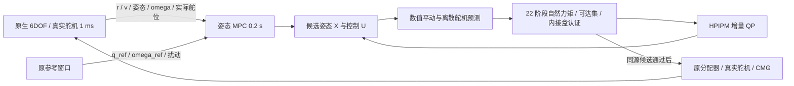

# Simulink 在线气动力矩约束修复

分支：`experiment/simulink-online-torque-authority`。基线：`eb5567684457feb1ad5ee44714912348678e95b1`。

**状态：在线力矩约束缺陷已接入修复，正式 A/B 默认启用完整未来预测。18 组 L0/L1/L2 × A/B × 2/10/60 s 实际运行完成，回退均为 0；保存重开及 CMG 回归通过。尚未满足 200 ms 硬实时预算。**

## 修复内容

正式 flight 模式默认采用 `online_predicted`。控制器新增独立飞行/舵机反馈端口，每个 0.2 s 控制周期从当前真实位置、机体系速度、姿态、角速度、实际舵位和上一分配命令重新开始。未来位置、速度和舵机状态均为预测值，不从预设弹道恢复。

`native_mpc_sfun` 在在线模式不再把参考窗口的旧 `tau_min/max` 写入求解模板。生成模型的模板上下界故意设为 NaN，参考窗口中兼容保留的上下界槽填零。真正传给 `assemble_native_qp` 的上下界来自当轮 `online_authority_rollout`。

每次 RTI 的名义点和每个线搜索候选均重新生成姿态、平动、舵机预测和能力盒。候选若越界，先进行一次有界、因果的逐阶段可行恢复：在该阶段当前预测状态计算盒、修正控制，再使用修正后的控制推进姿态和平动到下一节点；最后由 `verify_authority_candidate` 检查整条同源轨迹。不存在使用旧盒裁剪后沿用旧 X 的路径。无法恢复、越出物理表范围或求解失败的候选被拒绝。

求解失败时，根据当前实测状态重新计算保守舵面命令对应的总气动力矩，并按原限速/加速度限制减小 CMG 速率。不会复用已经过时的 `state.last`，也不读取旧力矩盒。当前实测状态本身越出模型有效范围时明确报错。

同时修复了 B 组模型重建的初态越界：参考 bank 只有共同的 7 个姿态状态时，从原 B 组模板 `X_nom(8:11,1)` 读取既有 CMG 初始构型。消融报告会检查各配置同一组初态完全一致。

## 实现文件与接口

| 文件 | 职责 |
|---|---|
| `hpipm/native_rti_step.m` | 保留旧路径，按显式模式进入在线 RTI |
| `hpipm/native_online_rti_step.m` | 在线初始化、每轮 QP、候选恢复、代价比较、失败回退 |
| `hpipm/online_authority_rollout.m` | 每次从真实状态重置的 22 阶段同源预测与约束 |
| `hpipm/online_translation_prediction.m` | 独立数值平动 RK4 与四元数 slerp |
| `hpipm/online_flight_condition.m` | 同源密度、空速、动压、迎角和侧滑角 |
| `hpipm/online_aero_moment.m` | 自然力矩、耦合舵效与总气动力矩 |
| `hpipm/online_surface_reachability.m` | 与真实 1 ms 离散舵机递推等价的可达区间 |
| `hpipm/online_certified_torque_box.m` | 八顶点认证的内接盒，支持秩亏 |
| `hpipm/online_certify_servo_vertices.m` | 反求顶点命令，认证整段单调舵机路径 |
| `hpipm/verify_authority_candidate.m` | 相同 X/U/Z 的边界、原点、CMG 与证书复核 |
| `hpipm/native_mpc_sfun.m` | 新实测端口、在线/旧参考隔离、原始诊断日志 |
| `modelgen/build_closedloop.m` | 生产 A/B 的全部结构生成和独立结果目录 |
| `modelgen/build_online_authority.m` | 可见的原生静态物理链与认证边界监视模块 |
| `modelgen/build_prediction_flight_environment.m` | 独立 Aerospace 原生 6DOF 回放模型 |

路径均相对于 `simulink/`。

控制器第 1 输入保持 A/B 的 6/10 维 `[Euler;omega;gamma]`；第 2 输入保持原扁平参考布局；新增第 3 输入为 12 维 `[r_NED(3);v_body(3);delta_actual(3);previous_allocator_command(3)]`。最后三维来自 0.2 s UnitDelay，不构成代数环，也没有改变原分配器控制策略。第 1 输出仍为 A/B 的 3/7 维控制，第 2 输出是 8 维监视量 `[tau_min(3);tau_max(3);scale;vertex_residual]`。



## 物理口径和约束

参数只读取原 `vehicle_params` 对应的 native_baseline MAT、`native_environment.mat` 和公开 `force_polar.mat`；没有复制一套车辆参数。采用 NED、scalar-first 四元数；`v_body=R'v_NED`，机体系气动力经 R 转回 NED 后只加一次 `9.80665 m/s²` 重力。平动不加入 HPIPM 决策变量。

自然力矩严格包含原静态偏置、迎角/侧滑角项和速度归一化角速度阻尼。总气动力矩为 `tau_nat+B_delta*delta`，舵面顺序 `[de,da,dr]`，力矩顺序 `[roll,pitch,yaw]`。不包含 CMG 力矩或外加扰动；自然力矩偏置可以使完整区间为负。

维持原 A/B 状态和控制维度、HPIPM、原姿态预测 MEX、代价及 22 段非均匀 dts。平动数值积分采用不超过 0.1 s 的 RK4 子步和 slerp；已与 1 ms 子步作独立误差对照。真实执行器仍是 1 ms。舵机预测使用相同离散递推的分段闭式计算，包含速率限制前缀和一阶跟踪尾段，不用 `delta±rate*dt` 外包界冒充充分可达集。

可达舵位区间还与原分配器允许的命令区间相交。三轴盒围绕可实现舵位中心建立，八顶点分别认证，保留滚转/偏航耦合。满秩时可解析计算内接缩放；秩亏时使用既有受限分配和二分。对每个顶点反求有界常值舵机命令并检查终点残差；常值命令下离散状态单调，起点、终点及命令界与速率饱和递推共同保证整个路径满足执行器约束。

**能力证书表示该阶段端点舵位/力矩的动态可达性，不表示有惯性的真实舵机能在整个区间瞬间产生恒定理想力矩。** 名义舵位仍由原受限分配命令经过真实离散舵机模型滚动，并记录跟踪滞后残差。姿态 MPC 的原理想阶段力矩模型与真实舵机之间仍存在这一建模近似；全程同时刻命令/实际力矩误差用于量化它。

## 原生模型

`models/Prediction_FlightEnvironment.slx` 保留 Aerospace `aerolib6dof/6DoF (Quaternion)`，复用原环境和公开气动力模块。它只用于独立回放验证，姿态由原生刚体自然演化，没有强塞 MPC 姿态，也没有在 S-function Outputs 内嵌套调用 sim。

`models/Online_Surface_Authority.slx` 包含可见的 `Flight_State_In`、`Flight_Condition`、`Natural_Moment`、`Surface_Effectiveness`、`Actuator_Reachability`、`Authority_Bounds` 和 `Diagnostics`。采用原生基础模块和复制的同源物理子系统；没有新增 MATLAB Function/Fcn/S-Function 来包裹整个物理链。该模块显示当前物理量与 RTI 认证结果；多次非线性迭代和几何认证属于 MPC 算法层 .m。

原生模块清单见 `results/online_authority/module/inventory.csv`、`stage_B/native_model_inventory.csv` 和 `reopen/*_model_inventory.csv`。生产 A/B 模型均由构建脚本保存，旧模型保存在 `frozen_models/`。

## 验证和结果

全部实验由本机 MATLAB R2024a、Simulink、Aerospace Blockset 与原 HPIPM 实际执行，没有用 Python 替代闭环。新旧原始结果分目录保存。

- 阶段 A：120 组原气动模型三输出对照，气动力矩最大误差约 `1.42e-13 N·m`；另 120 组新可见能力模块自然力矩/舵效对照通过 `<1e-8` 门槛。真实离散舵机端点对照误差约 `1.94e-15 rad`，并覆盖零动压、舵面限位和秩亏映射。
- 阶段 B：静态、俯仰、滚转、大迎角四类原生 6DOF 回放，覆盖 23.2 s。密集回放最大位置误差约 `1.11e-9 m`；22 段节点姿态插值最大位置/速度误差约 `4.56e-5 m / 4.09e-6 m/s`。实际运行积分子步另外与 1 ms 参考比较，门槛为全状态差 `<0.001`。
- 阶段 C：A/B 单次 MPC 调用、旧边界 NaN 隔离、强制失败不复用旧命令、不同名义控制造成未来气动条件变化、3×N 边界和顶点残差检查。原始数据在 `stage_C/`。
- 阶段 D：L0 是冻结离线盒，L1 是冻结当前气动条件的诊断消融，L2 是完整未来预测。完整原始运行见 `L0_*`、`L1_*`、`L2_*`。最终对照只选择同组、同初态、同持续时间的最终实现版本，见 `final_comparison.csv`。探索阶段的“只拒绝不恢复”版本仍保留证据，但不能作为最终修复指标。

汇总脚本计算姿态 RMS/峰值、同一时刻三轴力矩 RMS/峰值、舵偏和速率饱和时长、分配/顶点/舵机残差、回退、控制耗时、预测与真实未来量误差及 CMG 活动。每个完成的运行目录包含 MAT、JSON 和误差图；完整 CSV 见 `results/online_authority/closedloop_metrics.csv`。`final_comparison.csv` 是最终版本对照表。

### 最终 60 s 全程对照

| 配置 | 组 | 姿态 RMS / deg | 姿态峰值 / deg | 俯仰命令－实际力矩 RMS / N·m |
|---|---|---:|---:|---:|
| L0 离线盒 | A | 6.25371 | 15.35318 | 20.78554 |
| L0 离线盒 | B | 1.17760 | 2.44935 | 21.26478 |
| L1 当前条件冻结 | A | 6.47778 | 14.69561 | 0.50371 |
| L1 当前条件冻结 | B | 2.17747 | 6.52720 | 0.41106 |
| L2 完整未来预测 | A | 4.00734 | 8.31051 | 0.55156 |
| L2 完整未来预测 | B | 1.17813 | 4.14433 | 0.51036 |

L2 的三轴力矩误差 RMS 分别为 A `[0.15406,0.55156,0.08089]`、B `[0.20048,0.51036,0.15007]` N·m。舵偏饱和时长 `[de,da,dr]` 分别为 A `[0,42.477,0.352]`、B `[0,14.780,0]` s；L0 分别为 `[26.488,47.519,35.335]`、`[28.674,34.737,38.765]` s。没有把不同时刻的峰值相减。

L2 A/B 平均控制耗时为 0.792/1.190 s，最坏为 2.521/2.554 s，明显超过 0.2 s。18 组运行的控制更新数分别为 11/51/301，日志确认相邻 MPC 调用相隔 0.2 s 仿真时间；仿真放慢墙钟运行，不代表实时部署。

最终 L2 的力矩盒八顶点残差不超过 `3.56e-15 N·m`，舵机顶点反求残差不超过 `6.0e-15 rad`。实际未来量与预测量的最大误差（受以后闭环重规划影响）为：A/B 高度 0.0241/0.0574 m、速度 0.00110/0.00292 m/s、动压约 `1.15e-5/1.04e-5 Pa`、迎角 0.0843/0.0820 rad。不要把独立给定输入回放误差与这些闭环预测偏差混为一谈。

正式 60 s 原始结果目录为 `L2_60s_20261104_151658`（A）及 `L2_60s_20261104_152104`（B）。逐次 RTI 节点 CSV 位于 `stage_C/*_iteration_nodes.csv`，原始 MAT 保留完整轨迹、顶点命令和证书。

保存重开检查还定位并修复了 S-function 先声明 1 个输出、再改为 2 个输出导致监视线丢失的问题。现在一次性声明最终端口数，生成脚本自动关闭重开并检查三输入、两输出均连通。最后重新生成四个正式/诊断模型并运行保存后的 A/B 2 s；与最终长仿真版本先前的 2 s 轨迹逐点比较，控制和状态差异均为 **0**。这是监视连线修复，不改变已有 60 s 控制结果。`reopen/port_fix_equivalence.mat` 保存等价性结果；`check_actuation` 的四个 CMG 均确认运动。

分阶段提交：`22fb8ee` 为物理预测与认证基础，`5c83532` 为在线 RTI 核心修复。最终模型、连线持久化修复、报告和选定原始实验数据另行提交。探索运行保留在本地并按结果目录的 `.gitignore` 排除，最终表选中的数据明确纳入版本控制。

## 限制

公开升阻替代模型不是已辨识的高保真模型。它未包含舵偏对升阻/侧力的完整影响，本次没有擅自补充这些导数。未来每个非均匀阶段采用该阶段的名义分配命令保持和舵机滚动，下一次控制周期始终以实测状态重置；这不是未来闭环重规划的精确预测。

在线更新不等于满足 200 ms 实时计算预算；必须以最终表中的最坏和平均控制耗时为准。本次没有通过改目标项、增加控制维度、放大不可达边界来掩盖保守性。约束更可信不保证姿态误差更小，具体变化如实记录。

没有修改 nearspace/、configs/、simulink/py/ 或任何 Python 文件。没有重新生成原姿态 MEX，也没有改变真实 6DOF、CMG 和分配器策略。

## 重跑

从仓库根目录执行：

```matlab
addpath('simulink'); init_paths;
check_online_authority_static;
check_online_flight_prediction;
check_online_authority_integration;
run_online_frozen_baseline;
for duration=[2 10 60]
    build_closedloop(duration,true,false,'L1_diagnostic','online_current');
    build_closedloop(duration,true,true,'L1_diagnostic','online_current');
    build_closedloop(duration,true,false);
    build_closedloop(duration,true,true);
end
check_online_model_reopen;
export_online_node_diagnostics;
report_online_authority_closedloop;
```
