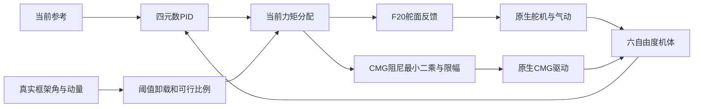

# 四组论文实验结果

基线 `01f055417448497304b04753102469930f0b8a2c`。全部结果来自原生 MATLAB/Simulink。正式模型、默认参考库的前后 SHA256 校验见 protected_inputs_final.json。

## 结果范围

本批次保留完整扫描点、有效域中断及基础设施失败。判据修订记录见 criteria_v2.md 和 criteria_E4_v3.md（后者是分析阶段透明修订，不是预注册）；旧标记保留在 legacy_status。附加 10° E2/E3 对照的原因和矩阵见 matrix_followup.json。原始 E3 缩短网格未对齐 1ms 物理时钟，不能用于时域因果结论；校正网格见 E3_followup。未通过卸载物理验收的 PID 卸载方法不计为有效基线。

## 主要数值结果

- E1 CMG=0：16 个扫描点，成功 2，跟踪失败 9，控制器失败 0，有效域中断 5。成功判据见 criteria_v2.md。
- E1 CMG=1：16 个扫描点，成功 7，跟踪失败 1，控制器失败 4，有效域中断 4。成功判据见 criteria_v2.md。
- E2 10°单次任务 PID_no_unload：RMSE 2.1631°，峰值 8.8651°，状态 TRACKING_FAIL。
- E2 10°单次任务 PID_reactive_unload：RMSE 2.1632°，峰值 8.8651°，状态 TRACKING_FAIL。
- E2 10°单次任务 MPC：RMSE 0.2794°，峰值 1.4142°，状态 SUCCESS。
- E3 相同 23.2 s 时域：完整未来 RMSE 0.2794°，屏蔽未来 RMSE 1.8911°。这支持未来任务信息对该工况跟踪效果的影响；构型变化起点是否可识别须查看 extra_metrics.json 的安静基线标记。
- E4 CMG=0：通过稳态误差判据的最高已测试频率 0.02 Hz；这是本次网格结果，不能外推为系统最高频率。
  幅频曲线跨越 -3 dB，但因飞行条件时变及参考预瞄，不直接报告为严格 LTI 带宽。
- E4 CMG=1：通过稳态误差判据的最高已测试频率 0.15 Hz；这是本次网格结果，不能外推为系统最高频率。
  幅频曲线跨越 -3 dB，但因飞行条件时变及参考预瞄，不直接报告为严格 LTI 带宽。

## E1

|工况|方法|状态|RMSE (deg)|峰值 (deg)|终止时间 (s)|
|---|---|---|---:|---:|---:|
|P001A|MPC|TRACKING_FAIL|1.0697|4.8759|60.000|
|P002B|MPC|SUCCESS|0.5964|3.4281|60.000|
|P003A|MPC|TRACKING_FAIL|0.8777|3.4947|60.000|
|P004B|MPC|SUCCESS|0.2794|1.4142|60.000|
|P005A|MPC|SUCCESS|0.6231|2.0006|60.000|
|P006B|MPC|SUCCESS|0.0272|0.1501|60.000|
|P007A|MPC|SUCCESS|0.3181|0.7692|60.000|
|P008B|MPC|SUCCESS|0.0134|0.1069|60.000|
|P009A|MPC|TRACKING_FAIL|3.2148|12.5707|60.000|
|P010B|MPC|TRACKING_FAIL|1.8165|8.3168|60.000|
|P011A|MPC|TRACKING_FAIL|2.4003|8.4421|60.000|
|P012B|MPC|SUCCESS|1.2901|5.5331|60.000|
|P013A|MPC|TRACKING_FAIL|1.9334|5.9271|60.000|
|P014B|MPC|SUCCESS|0.5164|2.1469|60.000|
|P015A|MPC|TRACKING_FAIL|1.4789|4.0062|60.000|
|P016B|MPC|SUCCESS|0.0269|0.1740|60.000|
|P017A|MPC|TRACKING_FAIL|6.8535|22.3789|60.000|
|P018B|MPC|MODEL_DOMAIN_FAIL|3.8909|15.1345|56.397|
|P019A|MPC|TRACKING_FAIL|5.5813|18.1188|60.000|
|P020B|MPC|MODEL_DOMAIN_FAIL|5.4813|10.7572|18.594|
|P021A|MPC|TRACKING_FAIL|3.7312|10.8645|60.000|
|P022B|MPC|MODEL_DOMAIN_FAIL|3.1283|6.0512|20.519|
|P023A|MPC|MODEL_DOMAIN_FAIL|3.1114|6.6344|43.410|
|P024B|MPC|MODEL_DOMAIN_FAIL|4.3260|8.0392|30.544|
|P025A|MPC|MODEL_DOMAIN_FAIL|24.9236|35.9176|41.129|
|P026B|MPC|CONTROLLER_FAIL|53.7433|86.5691|60.000|
|P027A|MPC|MODEL_DOMAIN_FAIL|23.7499|33.9425|41.129|
|P028B|MPC|CONTROLLER_FAIL|50.3010|84.0913|60.000|
|P029A|MPC|MODEL_DOMAIN_FAIL|21.8716|30.9632|41.129|
|P030B|MPC|CONTROLLER_FAIL|43.3952|72.4217|60.000|
|P031A|MPC|MODEL_DOMAIN_FAIL|16.9585|24.9897|40.782|
|P032B|MPC|CONTROLLER_FAIL|60.6674|109.3498|60.000|
|P061A|MPC|MODEL_DOMAIN_FAIL|7.3741|19.5767|41.201|
|P062B|MPC|MODEL_DOMAIN_FAIL|5.3776|11.1922|19.526|

RMSE 包含各次实际有效运行区间；截断工况不得与完整运行直接比较。每个工况目录保留 sim_output.mat、timeseries.csv、metrics.json、extra_metrics.json、跟踪 PNG/PDF 和失败堆栈。

## E1_baseline

|工况|方法|状态|RMSE (deg)|峰值 (deg)|终止时间 (s)|
|---|---|---|---:|---:|---:|
|BASE1A|MPC|TRACKING_FAIL|3.8703|8.4245|60.000|
|BASE1B|MPC|SUCCESS|0.3241|0.7679|60.000|
|BASE2A|MPC|TRACKING_FAIL|4.6783|10.2613|60.000|
|BASE2B|MPC|SUCCESS|0.4177|0.8843|60.000|

RMSE 包含各次实际有效运行区间；截断工况不得与完整运行直接比较。每个工况目录保留 sim_output.mat、timeseries.csv、metrics.json、extra_metrics.json、跟踪 PNG/PDF 和失败堆栈。

## E2

|工况|方法|状态|RMSE (deg)|峰值 (deg)|终止时间 (s)|
|---|---|---|---:|---:|---:|
|P033B|PID_no_unload|MODEL_DOMAIN_FAIL|11.0472|27.7618|51.209|
|P034B|PID_reactive_unload|MODEL_DOMAIN_FAIL|11.0472|27.7618|51.209|
|P035B|MPC|MODEL_DOMAIN_FAIL|5.4813|10.7572|18.594|
|P036B|PID_no_unload|TRACKING_FAIL|23.2306|33.4638|60.000|
|P037B|PID_reactive_unload|TRACKING_FAIL|23.2306|33.4638|60.000|
|P038B|MPC|TRACKING_FAIL|5.2271|12.7296|60.000|

RMSE 包含各次实际有效运行区间；截断工况不得与完整运行直接比较。每个工况目录保留 sim_output.mat、timeseries.csv、metrics.json、extra_metrics.json、跟踪 PNG/PDF 和失败堆栈。

## E2_followup

|工况|方法|状态|RMSE (deg)|峰值 (deg)|终止时间 (s)|
|---|---|---|---:|---:|---:|
|F001B|PID_no_unload|TRACKING_FAIL|2.1631|8.8651|60.000|
|F002B|PID_reactive_unload|TRACKING_FAIL|2.1632|8.8651|60.000|
|F003B|MPC|SUCCESS|0.2794|1.4142|60.000|
|F004B|PID_no_unload|TRACKING_FAIL|3.3527|8.9621|60.000|
|F005B|PID_reactive_unload|TRACKING_FAIL|3.4109|9.4486|60.000|
|F006B|MPC|SUCCESS|0.6021|2.1242|60.000|

RMSE 包含各次实际有效运行区间；截断工况不得与完整运行直接比较。每个工况目录保留 sim_output.mat、timeseries.csv、metrics.json、extra_metrics.json、跟踪 PNG/PDF 和失败堆栈。

## E3

|工况|方法|状态|RMSE (deg)|峰值 (deg)|终止时间 (s)|
|---|---|---|---:|---:|---:|
|P039B|MPC|CONTROLLER_FAIL|45.0996|68.0683|60.000|
|P040B|MPC|CONTROLLER_FAIL|45.0996|68.0683|60.000|
|P041B|MPC|CONTROLLER_FAIL|45.0996|68.0683|60.000|
|P042B|MPC|CONTROLLER_FAIL|45.0996|68.0683|60.000|
|P043B|MPC|MODEL_DOMAIN_FAIL|5.4813|10.7572|18.594|
|P044B|MPC|MODEL_DOMAIN_FAIL|13.2440|26.8335|30.134|

RMSE 包含各次实际有效运行区间；截断工况不得与完整运行直接比较。每个工况目录保留 sim_output.mat、timeseries.csv、metrics.json、extra_metrics.json、跟踪 PNG/PDF 和失败堆栈。

## E3_followup

|工况|方法|状态|RMSE (deg)|峰值 (deg)|终止时间 (s)|
|---|---|---|---:|---:|---:|
|F007B|MPC|SUCCESS|0.4584|2.3663|60.000|
|F008B|MPC|SUCCESS|0.2744|1.4949|60.000|
|F009B|MPC|SUCCESS|0.2334|1.1555|60.000|
|F010B|MPC|SUCCESS|0.2398|1.2014|60.000|
|F011B|MPC|SUCCESS|0.2794|1.4142|60.000|
|F012B|MPC|TRACKING_FAIL|1.8911|7.8145|60.000|

RMSE 包含各次实际有效运行区间；截断工况不得与完整运行直接比较。每个工况目录保留 sim_output.mat、timeseries.csv、metrics.json、extra_metrics.json、跟踪 PNG/PDF 和失败堆栈。

## E4

|工况|方法|状态|RMSE (deg)|峰值 (deg)|终止时间 (s)|
|---|---|---|---:|---:|---:|
|P053A|MPC|TRACKING_FAIL|0.5752|1.0266|58.000|
|P054B|MPC|SUCCESS|0.0243|0.1339|58.000|
|P055A|MPC|TRACKING_FAIL|0.5647|0.9955|48.000|
|P056B|MPC|TRACKING_FAIL|0.5725|1.8237|48.000|
|P057A|MPC|TRACKING_FAIL|0.6005|1.0886|34.666|
|P058B|MPC|SUCCESS|0.1020|0.3058|34.666|
|P059A|MPC|TRACKING_FAIL|0.5786|1.1801|28.000|
|P060B|MPC|TRACKING_FAIL|0.3366|0.8569|28.000|

RMSE 包含各次实际有效运行区间；截断工况不得与完整运行直接比较。每个工况目录保留 sim_output.mat、timeseries.csv、metrics.json、extra_metrics.json、跟踪 PNG/PDF 和失败堆栈。

## E4_followup

|工况|方法|状态|RMSE (deg)|峰值 (deg)|终止时间 (s)|
|---|---|---|---:|---:|---:|
|F013A|MPC|SUCCESS|0.1148|0.4839|408.000|
|F014B|MPC|SUCCESS|0.0158|0.1044|408.000|
|F015A|MPC|SUCCESS|0.1640|0.4688|208.000|
|F016B|MPC|SUCCESS|0.0201|0.1044|208.000|
|F017A|MPC|TRACKING_FAIL|0.5083|0.8968|108.000|
|F018B|MPC|SUCCESS|0.0100|0.1078|108.000|
|F019A|MPC|TRACKING_FAIL|0.5294|0.9376|74.666|
|F020B|MPC|SUCCESS|0.0117|0.1024|74.666|
|F021A|MPC|TRACKING_FAIL|0.5742|1.0266|58.000|
|F022B|MPC|SUCCESS|0.0243|0.1339|58.000|
|F023A|MPC|TRACKING_FAIL|0.5647|0.9955|48.000|
|F024B|MPC|TRACKING_FAIL|0.5725|1.8237|48.000|
|F025A|MPC|TRACKING_FAIL|0.6005|1.0886|34.666|
|F026B|MPC|SUCCESS|0.1020|0.3058|34.666|
|F027A|MPC|TRACKING_FAIL|0.5786|1.1801|28.000|
|F028B|MPC|TRACKING_FAIL|0.3366|0.8569|28.000|

RMSE 包含各次实际有效运行区间；截断工况不得与完整运行直接比较。每个工况目录保留 sim_output.mat、timeseries.csv、metrics.json、extra_metrics.json、跟踪 PNG/PDF 和失败堆栈。

## 未生成完整指标的失败与阻断

- D:\项目\飞轮\simulink\results\paper_experiments\20261105_paper_v2\E4\P045A: INFRA_FAIL。错误堆栈见该目录 run_status.json。
- D:\项目\飞轮\simulink\results\paper_experiments\20261105_paper_v2\E4\P046B: INFRA_FAIL。错误堆栈见该目录 run_status.json。
- D:\项目\飞轮\simulink\results\paper_experiments\20261105_paper_v2\E4\P047A: INFRA_FAIL。错误堆栈见该目录 run_status.json。
- D:\项目\飞轮\simulink\results\paper_experiments\20261105_paper_v2\E4\P048B: INFRA_FAIL。错误堆栈见该目录 run_status.json。
- D:\项目\飞轮\simulink\results\paper_experiments\20261105_paper_v2\E4\P049A: INFRA_FAIL。错误堆栈见该目录 run_status.json。
- D:\项目\飞轮\simulink\results\paper_experiments\20261105_paper_v2\E4\P050B: INFRA_FAIL。错误堆栈见该目录 run_status.json。
- D:\项目\飞轮\simulink\results\paper_experiments\20261105_paper_v2\E4\P051A: INFRA_FAIL。错误堆栈见该目录 run_status.json。
- D:\项目\飞轮\simulink\results\paper_experiments\20261105_paper_v2\E4\P052B: INFRA_FAIL。错误堆栈见该目录 run_status.json。

## 复现命令

从仓库根目录经 simulink/mlab.cmd 启动 MATLAB，先 addpath('simulink'); init_paths; addpath('simulink/paper'); 再执行 run_paper_suite('all','20261105_paper_v2')。支持 preflight/smoke/E1/E2/E3/E4/report；report 只从已有日志生成报告，不启动仿真。原始数据不提交版本库。

## PID 与卸载验证

反馈为 tau=Kp*eq+Ki*I-Kd*(omega-omega_ref)，仅用当前参考；两种 PID 共用增益。Kp=[675,4781.25,5062.5]，Ki=[13.5,95.625,101.25]，Kd=[1530,10837.5,11475]。独立校准候选见 pid_calibration/tuning.json。H_on=80、H_off=60 N m s，k_H=0.1，qbar_min=1 Pa。

卸载补偿按真实可交付 CMG 增量计算：tau_a_unload=A*(nu-nu_base)，tau_cmg_unload=-tau_a_unload；无舵面权限或动压不足时不卸载。框架速度与相邻命令加速度均受原始物理参数限制。

独立卸载物理验收 passed=1；原始数据与开关/补偿日志见 unload_acceptance/。不代表每个 E2 任务都触发卸载；触发次数见 extra_metrics.json。

## 结论限制

仅在共同有效、完整运行和相同参考下比较。E1 是离散闭环任务成功区域，不是理论可达域。E3 框架提前运动不能单独证明主动卸载或奇异性优化。E4 是含未来参考预瞄的时变飞行段正弦跟踪，不能等同常规因果反馈闭环带宽；本报告不宣称严格 LTI 带宽。低频长时间参考的扰动延长验证误差见 bank.disturbance_validation，使用原有公式和原生空气密度表，没有调用 Python。计算耗时是本机同步仿真测量，不是硬件实时验证。所有验收未覆盖项仍属未完成，不得把批处理退出码视为论文验收通过。
