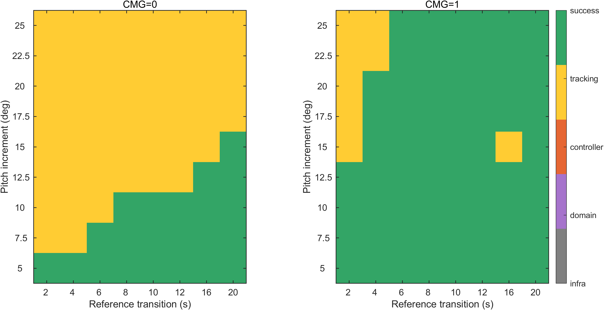
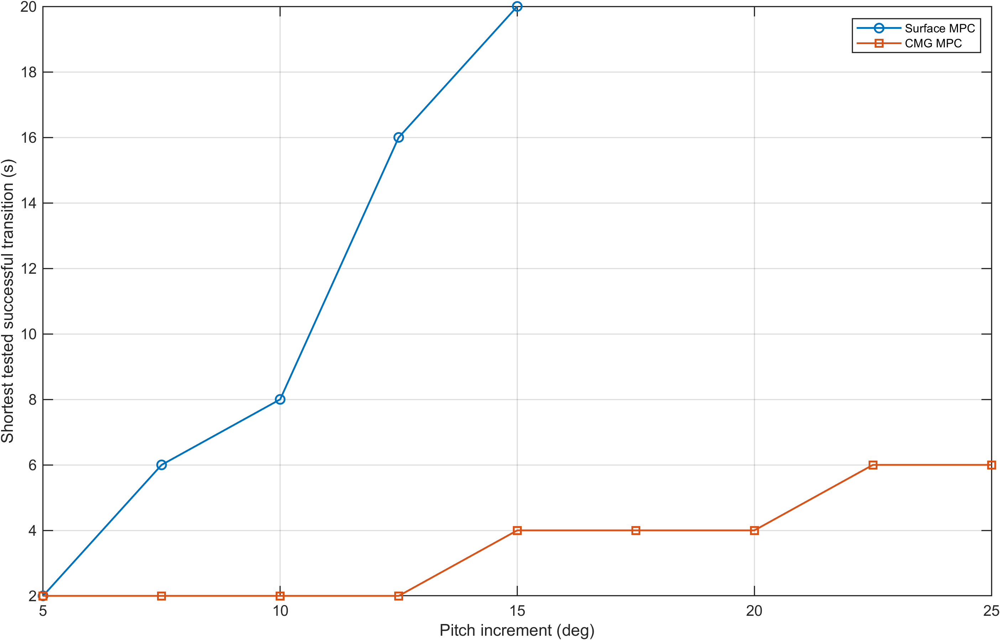

# E1 新批次实验结果

实际状态 144/144，已分析 144。历史数据不计入本批次。模型有效域中断不等于不可完成机动；仅完整且有效的运行可比较 RMSE。

|配置|方法|状态|完整|全程 RMSE °|部分 RMSE °|实际终点 s|
|---|---|---|---:|---:|---:|---:|
|V1_0050_0020_A|MPC|SUCCESS|1|0.4243|0.4243|60.000|
|V1_0050_0020_B|MPC|SUCCESS|1|0.1992|0.1992|60.000|
|V1_0050_0040_A|MPC|SUCCESS|1|0.3622|0.3622|60.000|
|V1_0050_0040_B|MPC|SUCCESS|1|0.0859|0.0859|60.000|
|V1_0050_0060_A|MPC|SUCCESS|1|0.2683|0.2683|60.000|
|V1_0050_0060_B|MPC|SUCCESS|1|0.0301|0.0301|60.000|
|V1_0050_0080_A|MPC|SUCCESS|1|0.2068|0.2068|60.000|
|V1_0050_0080_B|MPC|SUCCESS|1|0.0148|0.0148|60.000|
|V1_0050_0100_A|MPC|SUCCESS|1|0.1750|0.1750|60.000|
|V1_0050_0100_B|MPC|SUCCESS|1|0.0178|0.0178|60.000|
|V1_0050_0120_A|MPC|SUCCESS|1|0.1052|0.1052|60.000|
|V1_0050_0120_B|MPC|SUCCESS|1|0.0135|0.0135|60.000|
|V1_0050_0160_A|MPC|SUCCESS|1|0.0559|0.0559|60.000|
|V1_0050_0160_B|MPC|SUCCESS|1|0.0126|0.0126|60.000|
|V1_0050_0200_A|MPC|SUCCESS|1|0.0417|0.0417|60.000|
|V1_0050_0200_B|MPC|SUCCESS|1|0.0127|0.0127|60.000|
|V1_0075_0020_A|MPC|TRACKING_FAIL|1|0.7133|0.7133|60.000|
|V1_0075_0020_B|MPC|SUCCESS|1|0.5590|0.5590|60.000|
|V1_0075_0040_A|MPC|TRACKING_FAIL|1|0.6121|0.6121|60.000|
|V1_0075_0040_B|MPC|SUCCESS|1|0.1857|0.1857|60.000|
|V1_0075_0060_A|MPC|SUCCESS|1|0.5806|0.5806|60.000|
|V1_0075_0060_B|MPC|SUCCESS|1|0.1334|0.1334|60.000|
|V1_0075_0080_A|MPC|SUCCESS|1|0.4482|0.4482|60.000|
|V1_0075_0080_B|MPC|SUCCESS|1|0.0232|0.0232|60.000|
|V1_0075_0100_A|MPC|SUCCESS|1|0.4107|0.4107|60.000|
|V1_0075_0100_B|MPC|SUCCESS|1|0.0156|0.0156|60.000|
|V1_0075_0120_A|MPC|SUCCESS|1|0.3272|0.3272|60.000|
|V1_0075_0120_B|MPC|SUCCESS|1|0.0160|0.0160|60.000|
|V1_0075_0160_A|MPC|SUCCESS|1|0.2392|0.2392|60.000|
|V1_0075_0160_B|MPC|SUCCESS|1|0.0132|0.0132|60.000|
|V1_0075_0200_A|MPC|SUCCESS|1|0.2191|0.2191|60.000|
|V1_0075_0200_B|MPC|SUCCESS|1|0.0133|0.0133|60.000|
|V1_0100_0020_A|MPC|TRACKING_FAIL|1|1.0698|1.0698|60.000|
|V1_0100_0020_B|MPC|SUCCESS|1|0.5964|0.5964|60.000|
|V1_0100_0040_A|MPC|TRACKING_FAIL|1|0.9690|0.9690|60.000|
|V1_0100_0040_B|MPC|SUCCESS|1|0.4013|0.4013|60.000|
|V1_0100_0060_A|MPC|TRACKING_FAIL|1|0.8196|0.8196|60.000|
|V1_0100_0060_B|MPC|SUCCESS|1|0.2120|0.2120|60.000|
|V1_0100_0080_A|MPC|SUCCESS|1|0.7947|0.7947|60.000|
|V1_0100_0080_B|MPC|SUCCESS|1|0.0592|0.0592|60.000|
|V1_0100_0100_A|MPC|SUCCESS|1|0.6231|0.6231|60.000|
|V1_0100_0100_B|MPC|SUCCESS|1|0.0272|0.0272|60.000|
|V1_0100_0120_A|MPC|SUCCESS|1|0.5423|0.5423|60.000|
|V1_0100_0120_B|MPC|SUCCESS|1|0.0154|0.0154|60.000|
|V1_0100_0160_A|MPC|SUCCESS|1|0.3902|0.3902|60.000|
|V1_0100_0160_B|MPC|SUCCESS|1|0.0199|0.0199|60.000|
|V1_0100_0200_A|MPC|SUCCESS|1|0.3181|0.3181|60.000|
|V1_0100_0200_B|MPC|SUCCESS|1|0.0134|0.0134|60.000|
|V1_0125_0020_A|MPC|TRACKING_FAIL|1|1.4106|1.4106|60.000|
|V1_0125_0020_B|MPC|SUCCESS|1|0.8162|0.8162|60.000|
|V1_0125_0040_A|MPC|TRACKING_FAIL|1|1.2272|1.2272|60.000|
|V1_0125_0040_B|MPC|SUCCESS|1|0.5256|0.5256|60.000|
|V1_0125_0060_A|MPC|TRACKING_FAIL|1|1.1289|1.1289|60.000|
|V1_0125_0060_B|MPC|SUCCESS|1|0.3267|0.3267|60.000|
|V1_0125_0080_A|MPC|TRACKING_FAIL|1|1.0125|1.0125|60.000|
|V1_0125_0080_B|MPC|SUCCESS|1|0.1201|0.1201|60.000|
|V1_0125_0100_A|MPC|TRACKING_FAIL|1|0.9655|0.9655|60.000|
|V1_0125_0100_B|MPC|SUCCESS|1|0.0289|0.0289|60.000|
|V1_0125_0120_A|MPC|TRACKING_FAIL|1|0.8047|0.8047|60.000|
|V1_0125_0120_B|MPC|SUCCESS|1|0.0313|0.0313|60.000|
|V1_0125_0160_A|MPC|SUCCESS|1|0.6696|0.6696|60.000|
|V1_0125_0160_B|MPC|SUCCESS|1|0.0146|0.0146|60.000|
|V1_0125_0200_A|MPC|SUCCESS|1|0.5788|0.5788|60.000|
|V1_0125_0200_B|MPC|SUCCESS|1|0.0131|0.0131|60.000|
|V1_0150_0020_A|MPC|TRACKING_FAIL|1|1.8254|1.8254|60.000|
|V1_0150_0020_B|MPC|TRACKING_FAIL|1|1.3352|1.3352|60.000|
|V1_0150_0040_A|MPC|TRACKING_FAIL|1|1.5725|1.5725|60.000|
|V1_0150_0040_B|MPC|SUCCESS|1|0.8601|0.8601|60.000|
|V1_0150_0060_A|MPC|TRACKING_FAIL|1|1.4456|1.4456|60.000|
|V1_0150_0060_B|MPC|SUCCESS|1|0.5346|0.5346|60.000|
|V1_0150_0080_A|MPC|TRACKING_FAIL|1|1.3475|1.3475|60.000|
|V1_0150_0080_B|MPC|SUCCESS|1|0.2665|0.2665|60.000|
|V1_0150_0100_A|MPC|TRACKING_FAIL|1|1.2125|1.2125|60.000|
|V1_0150_0100_B|MPC|SUCCESS|1|0.0746|0.0746|60.000|
|V1_0150_0120_A|MPC|TRACKING_FAIL|1|1.1225|1.1225|60.000|
|V1_0150_0120_B|MPC|SUCCESS|1|0.2287|0.2287|60.000|
|V1_0150_0160_A|MPC|TRACKING_FAIL|1|0.9626|0.9626|60.000|
|V1_0150_0160_B|MPC|TRACKING_FAIL|1|0.5791|0.5791|60.000|
|V1_0150_0200_A|MPC|SUCCESS|1|0.8621|0.8621|60.000|
|V1_0150_0200_B|MPC|SUCCESS|1|0.0126|0.0126|60.000|
|V1_0175_0020_A|MPC|TRACKING_FAIL|1|2.4473|2.4473|60.000|
|V1_0175_0020_B|MPC|TRACKING_FAIL|1|1.4702|1.4702|60.000|
|V1_0175_0040_A|MPC|TRACKING_FAIL|1|2.0090|2.0090|60.000|
|V1_0175_0040_B|MPC|SUCCESS|1|1.1350|1.1350|60.000|
|V1_0175_0060_A|MPC|TRACKING_FAIL|1|1.8426|1.8426|60.000|
|V1_0175_0060_B|MPC|SUCCESS|1|0.9159|0.9159|60.000|
|V1_0175_0080_A|MPC|TRACKING_FAIL|1|1.7356|1.7356|60.000|
|V1_0175_0080_B|MPC|SUCCESS|1|0.4476|0.4476|60.000|
|V1_0175_0100_A|MPC|TRACKING_FAIL|1|1.5292|1.5292|60.000|
|V1_0175_0100_B|MPC|SUCCESS|1|0.2063|0.2063|60.000|
|V1_0175_0120_A|MPC|TRACKING_FAIL|1|1.3930|1.3930|60.000|
|V1_0175_0120_B|MPC|SUCCESS|1|0.0767|0.0767|60.000|
|V1_0175_0160_A|MPC|TRACKING_FAIL|1|1.3326|1.3326|60.000|
|V1_0175_0160_B|MPC|SUCCESS|1|0.0248|0.0248|60.000|
|V1_0175_0200_A|MPC|TRACKING_FAIL|1|1.1855|1.1855|60.000|
|V1_0175_0200_B|MPC|SUCCESS|1|0.0143|0.0143|60.000|
|V1_0200_0020_A|MPC|TRACKING_FAIL|1|3.2148|3.2148|60.000|
|V1_0200_0020_B|MPC|TRACKING_FAIL|1|1.8222|1.8222|60.000|
|V1_0200_0040_A|MPC|TRACKING_FAIL|1|2.6477|2.6477|60.000|
|V1_0200_0040_B|MPC|SUCCESS|1|1.4259|1.4259|60.000|
|V1_0200_0060_A|MPC|TRACKING_FAIL|1|2.1972|2.1972|60.000|
|V1_0200_0060_B|MPC|SUCCESS|1|1.2083|1.2083|60.000|
|V1_0200_0080_A|MPC|TRACKING_FAIL|1|2.0792|2.0792|60.000|
|V1_0200_0080_B|MPC|SUCCESS|1|0.8152|0.8152|60.000|
|V1_0200_0100_A|MPC|TRACKING_FAIL|1|1.9334|1.9334|60.000|
|V1_0200_0100_B|MPC|SUCCESS|1|0.5117|0.5117|60.000|
|V1_0200_0120_A|MPC|TRACKING_FAIL|1|1.8075|1.8075|60.000|
|V1_0200_0120_B|MPC|SUCCESS|1|0.7893|0.7893|60.000|
|V1_0200_0160_A|MPC|TRACKING_FAIL|1|1.6326|1.6326|60.000|
|V1_0200_0160_B|MPC|SUCCESS|1|1.6810|1.6810|60.000|
|V1_0200_0200_A|MPC|TRACKING_FAIL|1|1.4789|1.4789|60.000|
|V1_0200_0200_B|MPC|SUCCESS|1|0.0269|0.0269|60.000|
|V1_0225_0020_A|MPC|TRACKING_FAIL|1|4.0058|4.0058|60.000|
|V1_0225_0020_B|MPC|TRACKING_FAIL|1|2.2353|2.2353|60.000|
|V1_0225_0040_A|MPC|TRACKING_FAIL|1|3.3508|3.3508|60.000|
|V1_0225_0040_B|MPC|TRACKING_FAIL|1|1.7908|1.7908|60.000|
|V1_0225_0060_A|MPC|TRACKING_FAIL|1|2.7753|2.7753|60.000|
|V1_0225_0060_B|MPC|SUCCESS|1|1.4039|1.4039|60.000|
|V1_0225_0080_A|MPC|TRACKING_FAIL|1|2.5583|2.5583|60.000|
|V1_0225_0080_B|MPC|SUCCESS|1|1.3141|1.3141|60.000|
|V1_0225_0100_A|MPC|TRACKING_FAIL|1|2.4425|2.4425|60.000|
|V1_0225_0100_B|MPC|SUCCESS|1|0.5628|0.5628|60.000|
|V1_0225_0120_A|MPC|TRACKING_FAIL|1|2.1608|2.1608|60.000|
|V1_0225_0120_B|MPC|SUCCESS|1|0.4448|0.4448|60.000|
|V1_0225_0160_A|MPC|TRACKING_FAIL|1|1.9440|1.9440|60.000|
|V1_0225_0160_B|MPC|SUCCESS|1|0.0466|0.0466|60.000|
|V1_0225_0200_A|MPC|TRACKING_FAIL|1|1.8594|1.8594|60.000|
|V1_0225_0200_B|MPC|SUCCESS|1|0.0181|0.0181|60.000|
|V1_0250_0020_A|MPC|TRACKING_FAIL|1|4.8747|4.8747|60.000|
|V1_0250_0020_B|MPC|TRACKING_FAIL|1|2.6931|2.6931|60.000|
|V1_0250_0040_A|MPC|TRACKING_FAIL|1|4.1447|4.1447|60.000|
|V1_0250_0040_B|MPC|TRACKING_FAIL|1|2.2283|2.2283|60.000|
|V1_0250_0060_A|MPC|TRACKING_FAIL|1|3.4669|3.4669|60.000|
|V1_0250_0060_B|MPC|SUCCESS|1|1.7514|1.7514|60.000|
|V1_0250_0080_A|MPC|TRACKING_FAIL|1|2.8971|2.8971|60.000|
|V1_0250_0080_B|MPC|SUCCESS|1|1.4110|1.4110|60.000|
|V1_0250_0100_A|MPC|TRACKING_FAIL|1|2.8033|2.8033|60.000|
|V1_0250_0100_B|MPC|SUCCESS|1|1.0523|1.0523|60.000|
|V1_0250_0120_A|MPC|TRACKING_FAIL|1|2.6892|2.6892|60.000|
|V1_0250_0120_B|MPC|SUCCESS|1|0.4900|0.4900|60.000|
|V1_0250_0160_A|MPC|TRACKING_FAIL|1|2.3540|2.3540|60.000|
|V1_0250_0160_B|MPC|SUCCESS|1|0.2396|0.2396|60.000|
|V1_0250_0200_A|MPC|TRACKING_FAIL|1|2.1094|2.1094|60.000|
|V1_0250_0200_B|MPC|SUCCESS|1|0.0141|0.0141|60.000|

原始数据：D:/项目/飞轮/simulink/results/paper_experiments/20261105_redesign_v1/E1/cases/<case_id>/sim_output.mat；参考、配置、状态、指标、timeseries 和 domain_diagnostics 与原始数据同目录。真实 CMG 速率/力矩直接取 cluster 物理端口，并通过原生几何交叉核对。

## 分析与边界

CMG=0：当前 72/72 条记录；通过22、跟踪失败50、控制器异常0、模型域外0、基础设施失败0。域外不是物理不可达，缺失记录不作为失败。

CMG=1：当前 72/72 条记录；通过64、跟踪失败8、控制器异常0、模型域外0、基础设施失败0。域外不是物理不可达，缺失记录不作为失败。

最短时间仅指已测试离散参考过渡时长；2s通过只能说明最短已测试为2s，不能断言理论下限。完整配对、可比较子集与失败明细见 E1_paired.csv。气动表迎角边界是当前替代模型的工程有效域保护，不是经验证的真实失速/飞行安全阈值。

共同完整可靠配对 72/72；其中A成功22、B成功64，B独有成功42、A独有成功0、共同成功22、共同未通过8。各自分母为共同配对数，不与全网格分母混用。

边界图固定选择规则：按幅值、过渡时长升序，分别选择第一个B独有成功、共同成功、任一域外配对；没有该类时不另造案例。详见 E1_boundary_selection.json 和对应 E1_boundary_*.png。绝对俯仰与参考初态见各case的detail_metrics.json。
