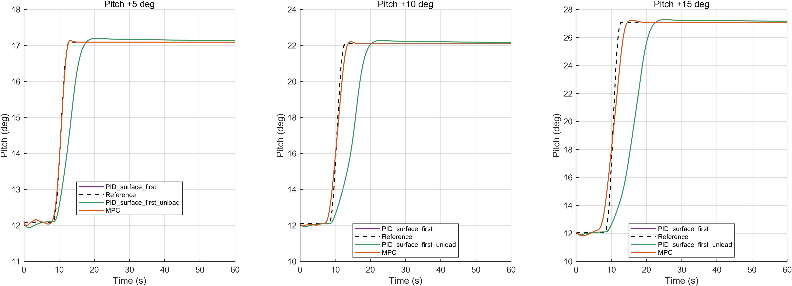
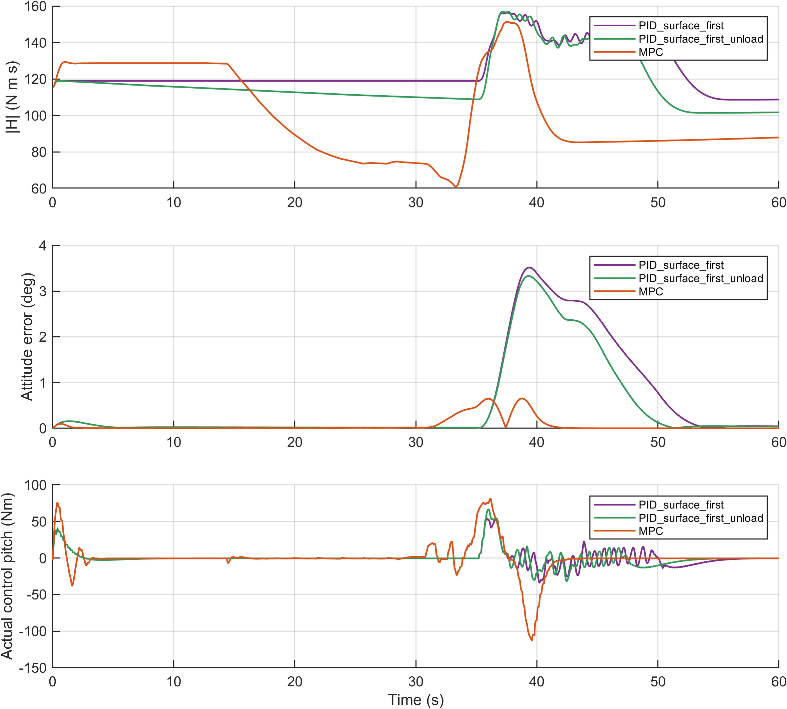
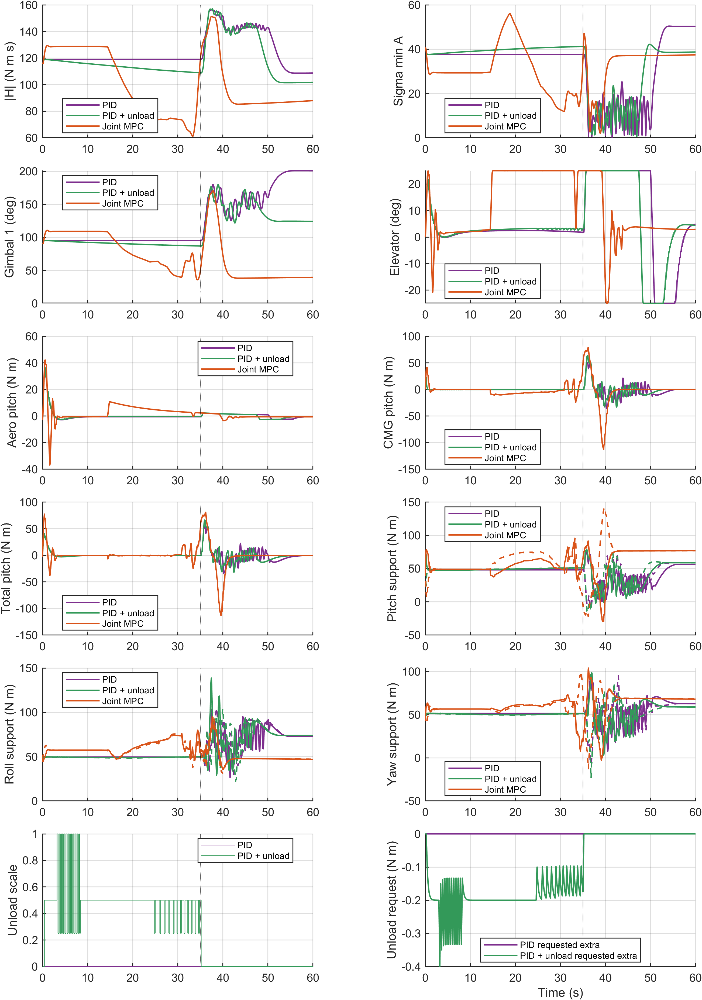
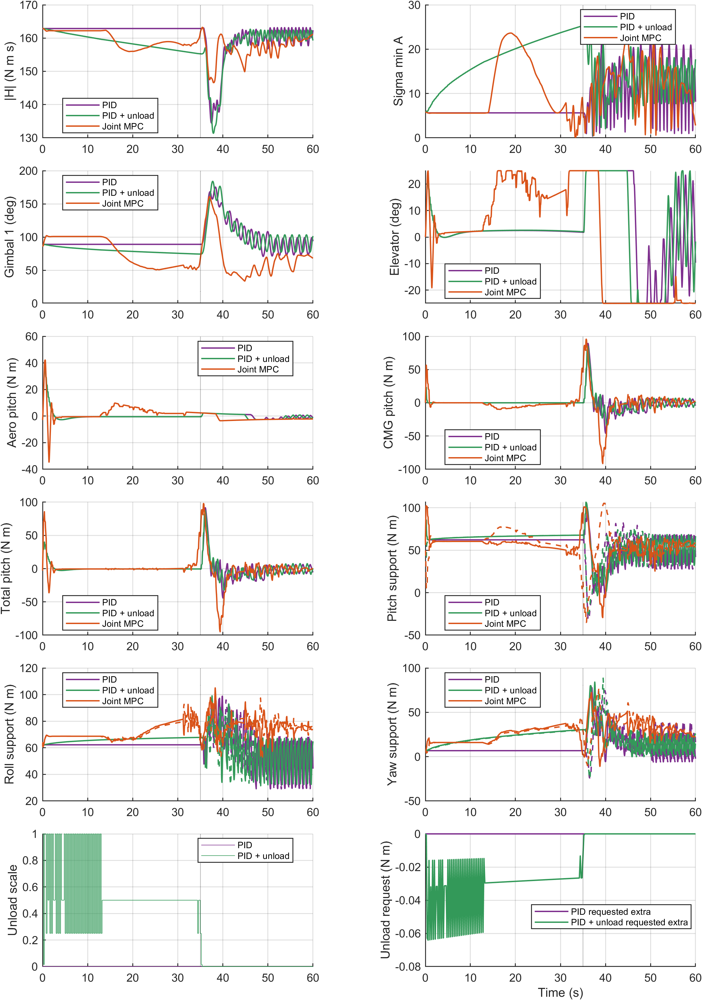
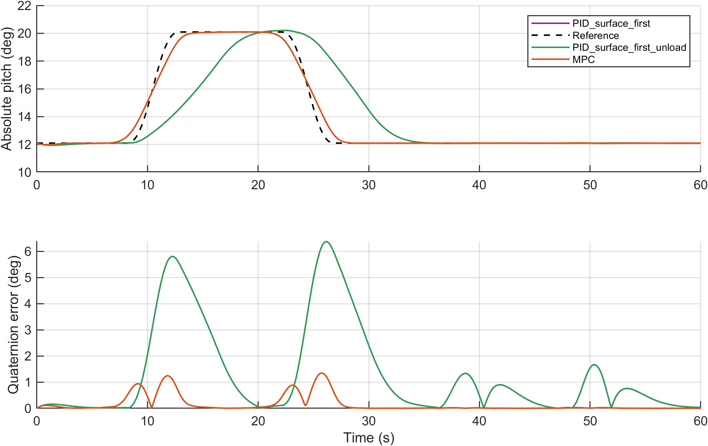
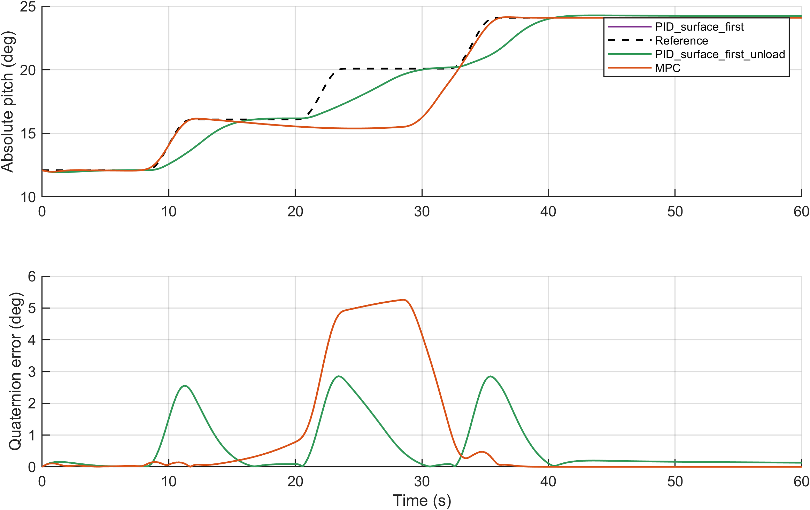

# E2 新批次实验结果

实际状态 21/21，已分析 21。历史数据不计入本批次。模型有效域中断不等于不可完成机动；仅完整且有效的运行可比较 RMSE。

|配置|方法|状态|完整|全程 RMSE °|部分 RMSE °|实际终点 s|
|---|---|---|---:|---:|---:|---:|
|V2_C1_1|PID_surface_first|TRACKING_FAIL|1|2.1946|2.1946|60.000|
|V2_C1_2|PID_surface_first_unload|TRACKING_FAIL|1|2.1946|2.1946|60.000|
|V2_C1_3|MPC|TRACKING_FAIL|1|0.3495|0.3495|60.000|
|V2_C2_1|PID_surface_first|TRACKING_FAIL|1|1.0481|1.0481|60.000|
|V2_C2_2|PID_surface_first_unload|TRACKING_FAIL|1|1.0481|1.0481|60.000|
|V2_C2_3|MPC|TRACKING_FAIL|1|1.8948|1.8948|60.000|
|V2_M1_1|PID_surface_first|TRACKING_FAIL|1|1.1686|1.1686|60.000|
|V2_M1_2|PID_surface_first_unload|TRACKING_FAIL|1|1.0067|1.0067|60.000|
|V2_M1_3|MPC|SUCCESS|1|0.1646|0.1646|60.000|
|V2_M2_1|PID_surface_first|TRACKING_FAIL|1|1.3481|1.3481|60.000|
|V2_M2_2|PID_surface_first_unload|TRACKING_FAIL|1|1.0102|1.0102|60.000|
|V2_M2_3|MPC|SUCCESS|1|0.2959|0.2959|60.000|
|V2_S05_1|PID_surface_first|SUCCESS|1|0.6507|0.6507|60.000|
|V2_S05_2|PID_surface_first_unload|SUCCESS|1|0.6507|0.6507|60.000|
|V2_S05_3|MPC|SUCCESS|1|0.0376|0.0376|60.000|
|V2_S10_1|PID_surface_first|TRACKING_FAIL|1|2.0231|2.0231|60.000|
|V2_S10_2|PID_surface_first_unload|TRACKING_FAIL|1|2.0231|2.0231|60.000|
|V2_S10_3|MPC|SUCCESS|1|0.2778|0.2778|60.000|
|V2_S15_1|PID_surface_first|TRACKING_FAIL|1|3.5789|3.5789|60.000|
|V2_S15_2|PID_surface_first_unload|TRACKING_FAIL|1|3.5789|3.5789|60.000|
|V2_S15_3|MPC|SUCCESS|1|0.6959|0.6959|60.000|

原始数据：D:/项目/飞轮/simulink/results/paper_experiments/20261105_redesign_v1/E2/cases/<case_id>/sim_output.mat；参考、配置、状态、指标、timeseries 和 domain_diagnostics 与原始数据同目录。真实 CMG 速率/力矩直接取 cluster 物理端口，并通过原生几何交叉核对。

## 分析与边界

冻结增益 Kp=[588,4165,4410]，Ki=[11.76,83.3,88.2]，Kd=[1411.2,9996,10584]。13个有限候选、4个独立任务，共52次标定；所有候选分数和失败见 calibration/tuning_scores.json。该整定不是全局最优PID保证。两种PID仅卸载开关不同；比较传统控制栈与联合MPC栈，不能把全部差异归为单独PID算法。

构型1：卸载关/开，末端H范数 108.7478/101.7182 Nms；后续机动段RMSE 2.2889/2.1802°；实际总控制力矩残差 RMS 95.5864/85.0939 Nm。必须在完整域内条件下解释收益或退化，H下降不等于方向控制权限恢复。

构型2：卸载关/开，末端H范数 162.3790/159.2772 Nms；后续机动段RMSE 2.0306/1.9865°；实际总控制力矩残差 RMS 104.5550/84.2746 Nm。必须在完整域内条件下解释收益或退化，H下降不等于方向控制权限恢复。

“实际总控制力矩”=实测气动力矩+CMG反作用力矩，不包含外扰及单列的omega×H耦合。真实舵机补偿存在滞后；不以命令增量相消声称实际瞬时相消。分事件指标见 E2_event_metrics.csv；C1末次机动52s结束，60s内仅观察到8s后段，不能声称覆盖完整10s后段。图中的分轴权限是冻结gamma的一拍方向支撑，非其他轴为零时的独立力矩能力。每个初始gamma/H/A/sigma均见各case/detail_metrics.json。

