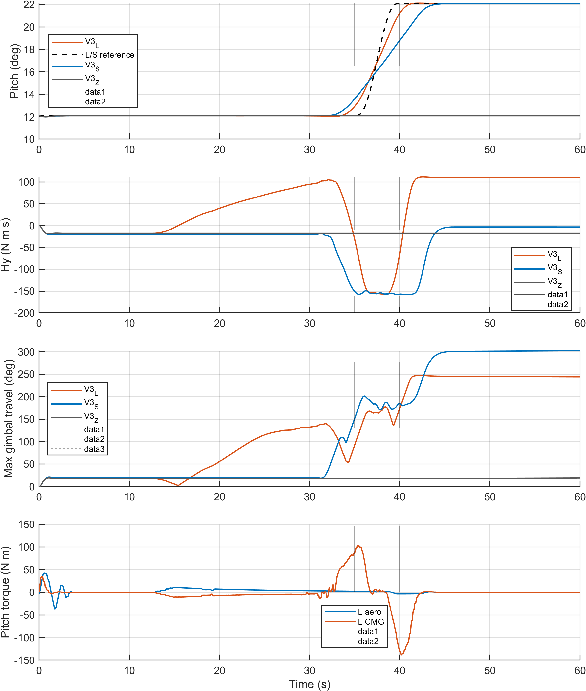
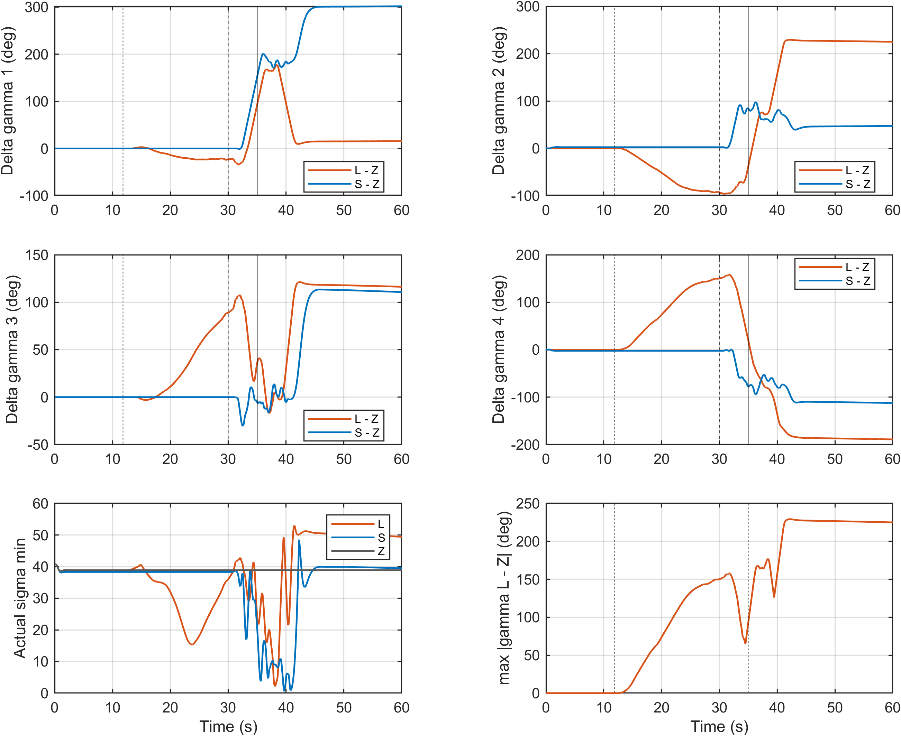

# E3 新批次实验结果

实际状态 3/3，已分析 3。历史数据不计入本批次。模型有效域中断不等于不可完成机动；仅完整且有效的运行可比较 RMSE。

|配置|方法|状态|完整|全程 RMSE °|部分 RMSE °|实际终点 s|
|---|---|---|---:|---:|---:|---:|
|V3_L|MPC|SUCCESS|1|0.3930|0.3930|60.000|
|V3_S|MPC|TRACKING_FAIL|1|0.8604|0.8604|60.000|
|V3_Z|MPC|SUCCESS|1|0.0127|0.0127|60.000|

原始数据：D:/项目/飞轮/simulink/results/paper_experiments/20261105_redesign_v1/E3/cases/<case_id>/sim_output.mat；参考、配置、状态、指标、timeseries 和 domain_diagnostics 与原始数据同目录。真实 CMG 速率/力矩直接取 cluster 物理端口，并通过原生几何交叉核对。

## 分析与边界

L/S机动段35–40s RMSE 1.3179/2.5172°；机动后40–50s RMSE 0.1546/1.0553°。Z是保持任务，不参加机动排名。

34.8s正俯仰一拍可达投影上界 L/S/Z=94.736/35.857/32.977 Nm；最小奇异值 30.586/25.967/38.851。这是冻结当前gamma、带真实当前框架速率和0.2s加速度盒约束的局部方向支撑，不是其他轴力矩为零的纯俯仰权限。

重要：三组10°绝对框架迁移阈值都在共同启动段1s内跨越。该绝对阈值提前量不能作为未来任务预置的独立证据；应看L−Z的任务相关构型差与11.8s之后的演化，不能将共同启动漂移宣称为预测性迁移。

准备段有效力矩阈值固定1 Nm，L反号比例86.72%，有效样本21874；反号只支持力矩配合现象，不能证明姿态没有代价。预测网格也不同，L/S不能单独识别迁移对跟踪的独立因果贡献。历史onset8s时域扫描另表，不混算新onset35s结果。

### 任务相对构型差（辅助诊断）

L−Z在11.8s以前最大框架差 0°；未来任务最早进入长时域11.8s、短时域30s。辅助诊断定义L−Z最大框架差超过2°并持续0.6s，首次时刻 13.4900 s。该量不能替代预先规定的10°绝对迁移主指标，也不能把S与L不同网格的所有差异归因于预测性迁移。

