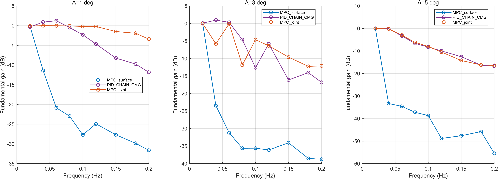
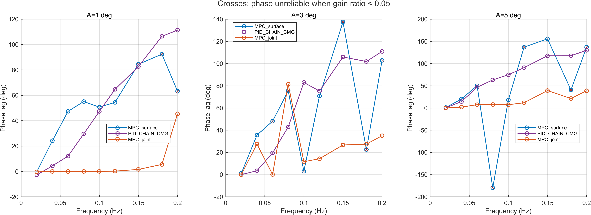
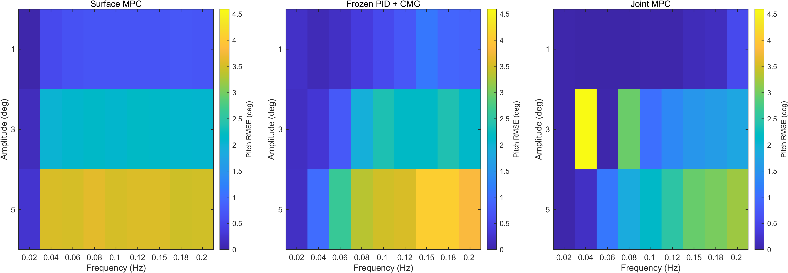
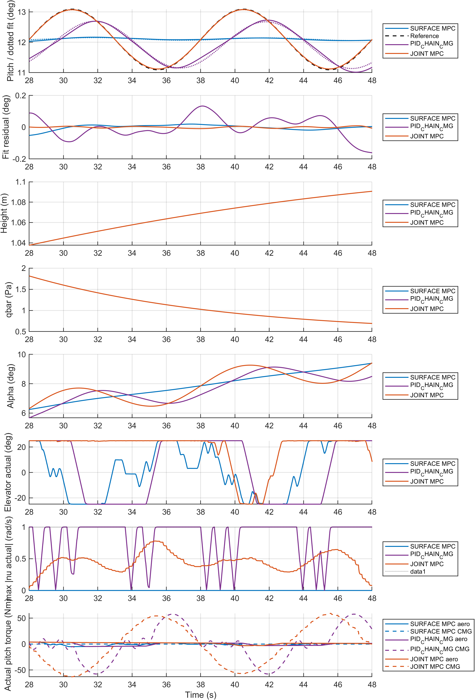
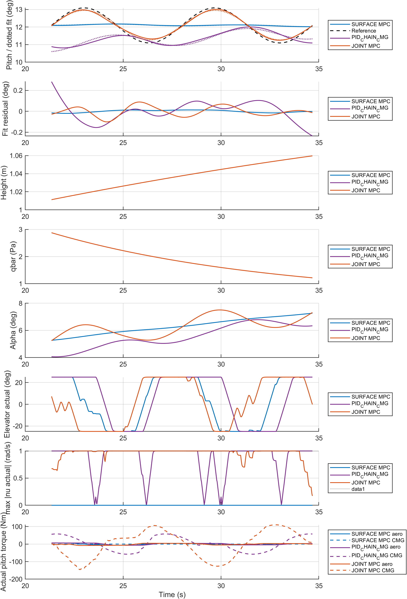

# E4 新批次实验结果

实际状态 81/81，已分析 81。历史数据不计入本批次。模型有效域中断不等于不可完成机动；仅完整且有效的运行可比较 RMSE。

|配置|方法|状态|完整|全程 RMSE °|部分 RMSE °|实际终点 s|
|---|---|---|---:|---:|---:|---:|
|V4_010_020_1|MPC|VALID_COMPLETE|1|0.1597|0.1597|208.000|
|V4_010_020_2|PID_CHAIN_CMG|VALID_COMPLETE|1|0.1596|0.1596|208.000|
|V4_010_020_3|MPC|VALID_COMPLETE|1|0.0202|0.0202|208.000|
|V4_010_040_1|MPC|VALID_POOR_TRACKING|1|0.5150|0.5150|108.000|
|V4_010_040_2|PID_CHAIN_CMG|VALID_COMPLETE|1|0.0970|0.0970|108.000|
|V4_010_040_3|MPC|VALID_COMPLETE|1|0.0101|0.0101|108.000|
|V4_010_060_1|MPC|VALID_POOR_TRACKING|1|0.5370|0.5370|74.666|
|V4_010_060_2|PID_CHAIN_CMG|VALID_COMPLETE|1|0.2184|0.2184|74.666|
|V4_010_060_3|MPC|VALID_COMPLETE|1|0.0132|0.0132|74.666|
|V4_010_080_1|MPC|VALID_POOR_TRACKING|1|0.5774|0.5774|58.000|
|V4_010_080_2|PID_CHAIN_CMG|VALID_COMPLETE|1|0.3400|0.3400|58.000|
|V4_010_080_3|MPC|VALID_COMPLETE|1|0.0240|0.0240|58.000|
|V4_010_100_1|MPC|VALID_POOR_TRACKING|1|0.5741|0.5741|48.000|
|V4_010_100_2|PID_CHAIN_CMG|VALID_POOR_TRACKING|1|0.4956|0.4956|48.000|
|V4_010_100_3|MPC|VALID_COMPLETE|1|0.0443|0.0443|48.000|
|V4_010_120_1|MPC|VALID_POOR_TRACKING|1|0.5774|0.5774|41.333|
|V4_010_120_2|PID_CHAIN_CMG|VALID_POOR_TRACKING|1|0.6505|0.6505|41.333|
|V4_010_120_3|MPC|VALID_COMPLETE|1|0.0299|0.0299|41.333|
|V4_010_150_1|MPC|VALID_POOR_TRACKING|1|0.6026|0.6026|34.666|
|V4_010_150_2|PID_CHAIN_CMG|VALID_POOR_TRACKING|1|0.8520|0.8520|34.666|
|V4_010_150_3|MPC|VALID_COMPLETE|1|0.0956|0.0956|34.666|
|V4_010_180_1|MPC|VALID_POOR_TRACKING|1|0.5934|0.5934|30.222|
|V4_010_180_2|PID_CHAIN_CMG|VALID_POOR_TRACKING|1|0.7598|0.7598|30.222|
|V4_010_180_3|MPC|VALID_COMPLETE|1|0.2033|0.2033|30.222|
|V4_010_200_1|MPC|VALID_POOR_TRACKING|1|0.5819|0.5819|28.000|
|V4_010_200_2|PID_CHAIN_CMG|VALID_POOR_TRACKING|1|0.7430|0.7430|28.000|
|V4_010_200_3|MPC|VALID_POOR_TRACKING|1|0.3922|0.3922|28.000|
|V4_030_020_1|MPC|VALID_COMPLETE|1|1.0762|1.0762|208.000|
|V4_030_020_2|PID_CHAIN_CMG|VALID_COMPLETE|1|0.2804|0.2804|208.000|
|V4_030_020_3|MPC|VALID_COMPLETE|1|0.0181|0.0181|208.000|
|V4_030_040_1|MPC|VALID_POOR_TRACKING|1|1.8019|1.8019|108.000|
|V4_030_040_2|PID_CHAIN_CMG|VALID_COMPLETE|1|0.9254|0.9254|108.000|
|V4_030_040_3|MPC|VALID_POOR_TRACKING|1|3.3369|3.3369|108.000|
|V4_030_060_1|MPC|VALID_POOR_TRACKING|1|1.8402|1.8402|74.666|
|V4_030_060_2|PID_CHAIN_CMG|VALID_COMPLETE|1|1.4255|1.4255|74.666|
|V4_030_060_3|MPC|VALID_COMPLETE|1|0.0393|0.0393|74.666|
|V4_030_080_1|MPC|VALID_POOR_TRACKING|1|1.8923|1.8923|58.000|
|V4_030_080_2|PID_CHAIN_CMG|VALID_POOR_TRACKING|1|2.2940|2.2940|58.000|
|V4_030_080_3|MPC|VALID_POOR_TRACKING|1|2.2431|2.2431|58.000|
|V4_030_100_1|MPC|VALID_POOR_TRACKING|1|1.8316|1.8316|48.000|
|V4_030_100_2|PID_CHAIN_CMG|VALID_POOR_TRACKING|1|2.0871|2.0871|48.000|
|V4_030_100_3|MPC|VALID_POOR_TRACKING|1|0.8271|0.8271|48.000|
|V4_030_120_1|MPC|VALID_POOR_TRACKING|1|1.8546|1.8546|41.333|
|V4_030_120_2|PID_CHAIN_CMG|VALID_POOR_TRACKING|1|2.4619|2.4619|41.333|
|V4_030_120_3|MPC|VALID_POOR_TRACKING|1|1.0605|1.0605|41.333|
|V4_030_150_1|MPC|VALID_POOR_TRACKING|1|1.8372|1.8372|34.666|
|V4_030_150_2|PID_CHAIN_CMG|VALID_POOR_TRACKING|1|1.9413|1.9413|34.666|
|V4_030_150_3|MPC|VALID_POOR_TRACKING|1|1.3240|1.3240|34.666|
|V4_030_180_1|MPC|VALID_POOR_TRACKING|1|1.7944|1.7944|30.222|
|V4_030_180_2|PID_CHAIN_CMG|VALID_POOR_TRACKING|1|2.5532|2.5532|30.222|
|V4_030_180_3|MPC|VALID_POOR_TRACKING|1|1.3455|1.3455|30.222|
|V4_030_200_1|MPC|VALID_POOR_TRACKING|1|1.7813|1.7813|28.000|
|V4_030_200_2|PID_CHAIN_CMG|VALID_POOR_TRACKING|1|2.5228|2.5228|28.000|
|V4_030_200_3|MPC|VALID_POOR_TRACKING|1|1.4466|1.4466|28.000|
|V4_050_020_1|MPC|VALID_COMPLETE|1|2.5082|2.5082|208.000|
|V4_050_020_2|PID_CHAIN_CMG|VALID_COMPLETE|1|1.0265|1.0265|208.000|
|V4_050_020_3|MPC|VALID_COMPLETE|1|0.0207|0.0207|208.000|
|V4_050_040_1|MPC|VALID_POOR_TRACKING|1|3.2808|3.2808|108.000|
|V4_050_040_2|PID_CHAIN_CMG|VALID_COMPLETE|1|1.5677|1.5677|108.000|
|V4_050_040_3|MPC|VALID_COMPLETE|1|0.1687|0.1687|108.000|
|V4_050_060_1|MPC|VALID_POOR_TRACKING|1|3.1834|3.1834|74.666|
|V4_050_060_2|PID_CHAIN_CMG|VALID_POOR_TRACKING|1|3.4037|3.4037|74.666|
|V4_050_060_3|MPC|VALID_COMPLETE|1|0.9805|0.9805|74.666|
|V4_050_080_1|MPC|VALID_POOR_TRACKING|1|3.2015|3.2015|58.000|
|V4_050_080_2|PID_CHAIN_CMG|VALID_POOR_TRACKING|1|3.8288|3.8288|58.000|
|V4_050_080_3|MPC|VALID_POOR_TRACKING|1|1.6085|1.6085|58.000|
|V4_050_100_1|MPC|VALID_POOR_TRACKING|1|3.1398|3.1398|48.000|
|V4_050_100_2|PID_CHAIN_CMG|VALID_POOR_TRACKING|1|3.4034|3.4034|48.000|
|V4_050_100_3|MPC|VALID_POOR_TRACKING|1|1.9056|1.9056|48.000|
|V4_050_120_1|MPC|VALID_POOR_TRACKING|1|3.1241|3.1241|41.333|
|V4_050_120_2|PID_CHAIN_CMG|VALID_POOR_TRACKING|1|3.8461|3.8461|41.333|
|V4_050_120_3|MPC|VALID_POOR_TRACKING|1|2.1964|2.1964|41.333|
|V4_050_150_1|MPC|VALID_POOR_TRACKING|1|3.0919|3.0919|34.666|
|V4_050_150_2|PID_CHAIN_CMG|VALID_POOR_TRACKING|1|4.1179|4.1179|34.666|
|V4_050_150_3|MPC|VALID_POOR_TRACKING|1|2.4743|2.4743|34.666|
|V4_050_180_1|MPC|VALID_POOR_TRACKING|1|2.9708|2.9708|30.222|
|V4_050_180_2|PID_CHAIN_CMG|VALID_POOR_TRACKING|1|4.4026|4.4026|30.222|
|V4_050_180_3|MPC|VALID_POOR_TRACKING|1|2.5427|2.5427|30.222|
|V4_050_200_1|MPC|VALID_POOR_TRACKING|1|2.9641|2.9641|28.000|
|V4_050_200_2|PID_CHAIN_CMG|VALID_POOR_TRACKING|1|4.3402|4.3402|28.000|
|V4_050_200_3|MPC|VALID_POOR_TRACKING|1|2.6547|2.6547|28.000|

原始数据：D:/项目/飞轮/simulink/results/paper_experiments/20261105_redesign_v1/E4/cases/<case_id>/sim_output.mat；参考、配置、状态、指标、timeseries 和 domain_diagnostics 与原始数据同目录。真实 CMG 速率/力矩直接取 cluster 物理端口，并通过原生几何交叉核对。

## 分析与边界

非整数终点按实际1ms网格记录，理论周期终点缺口小于1ms，不补造采样。主指标为末两个周期窗口的基频增益、正向相位滞后（参考相位减实际相位）及直接俯仰RMSE；VALID_POOR_TRACKING保留全部连续指标，不剔除不利频点。工程可接受区域固定为gain≥−3dB、绝对相位≤45°且俯仰RMSE≤0.5A，仅是辅助判据。

### 0.10/0.15Hz 专项审计

|频率|方法|CMG|gain dB|lag °|pitch RMSE °|bias °|fit residual °|qbar范围 Pa|
|---:|---|---:|---:|---:|---:|---:|---:|---|
|0.10|MPC|0|-27.701|50.699|0.686|0.014|0.015|0.691–1.81|
|0.10|PID_CHAIN_CMG|1|-2.315|47.284|0.553|-0.176|0.065|0.691–1.81|
|0.10|MPC|1|-0.198|0.046|0.018|0.003|0.005|0.691–1.81|
|0.15|MPC|0|-27.672|84.466|0.694|0.011|0.011|1.22–2.88|
|0.15|PID_CHAIN_CMG|1|-8.221|82.665|1.114|-0.745|0.093|1.22–2.88|
|0.15|MPC|1|-1.484|1.610|0.122|0.016|0.045|1.22–2.88|

在1°专项审计中，0.10/0.15Hz：仅舵面MPC均为低响应，PID均未满足固定工程判据，联合MPC均满足。因此旧的“0.10不通过、0.15通过”没有在本次1°三方法对照中重现；其他幅值/频点的非单调行为仍完整保留。

不同频率的飞行时间窗不同，机体高度/动压/迎角在变化，MPC含参考预瞄，不能把跨频率曲线称严格LTI频响或直接报告带宽倍数。异常原因须结合基频、相位、偏置、趋势、谐波和真实执行器/飞行状态解释；本报告不以平滑/删除点消除非单调现象。两份 anomaly_fit_metrics.csv 还记录末两周期内实际SQP尝试、QP求解、接受步均值与有拒绝步的周期比例。低响应gain ratio<0.05的相位只作带旗标记录，图中用叉标示，不能作可靠相位比较。灰色RMSE格子表示没有有效末段指标，不视作零误差。

非单调现象的唯一主因尚未通过固定飞行工况、固定网格等单变量反事实试验隔离；工况变化、参考预瞄、非均匀时域及有限SQP步都是需要区分的因素，不能仅凭这组多频率数据认定其中某项是唯一原因。

