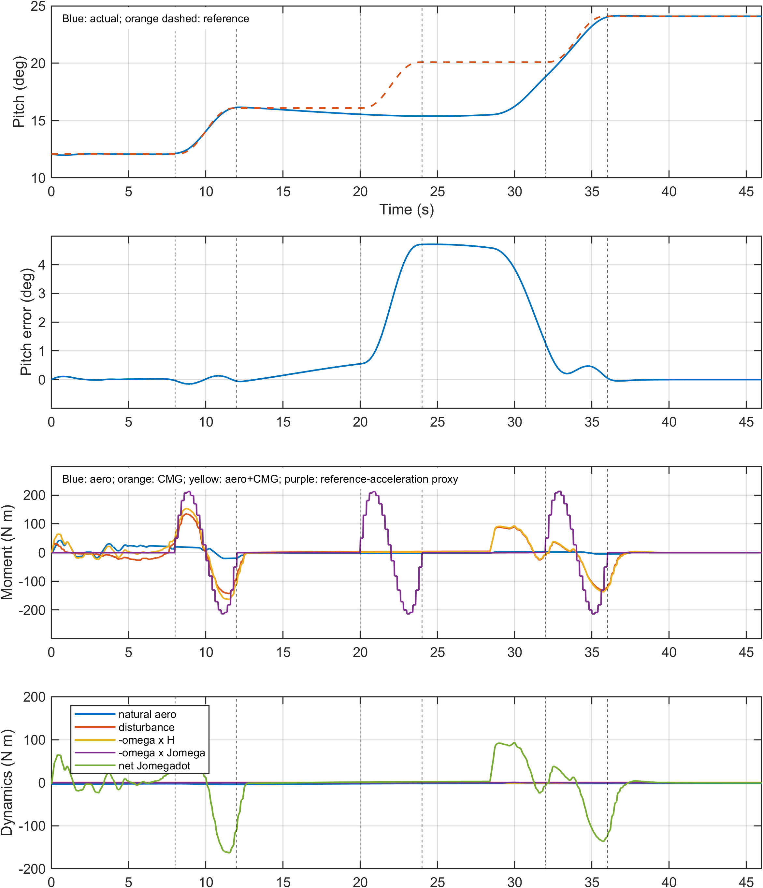
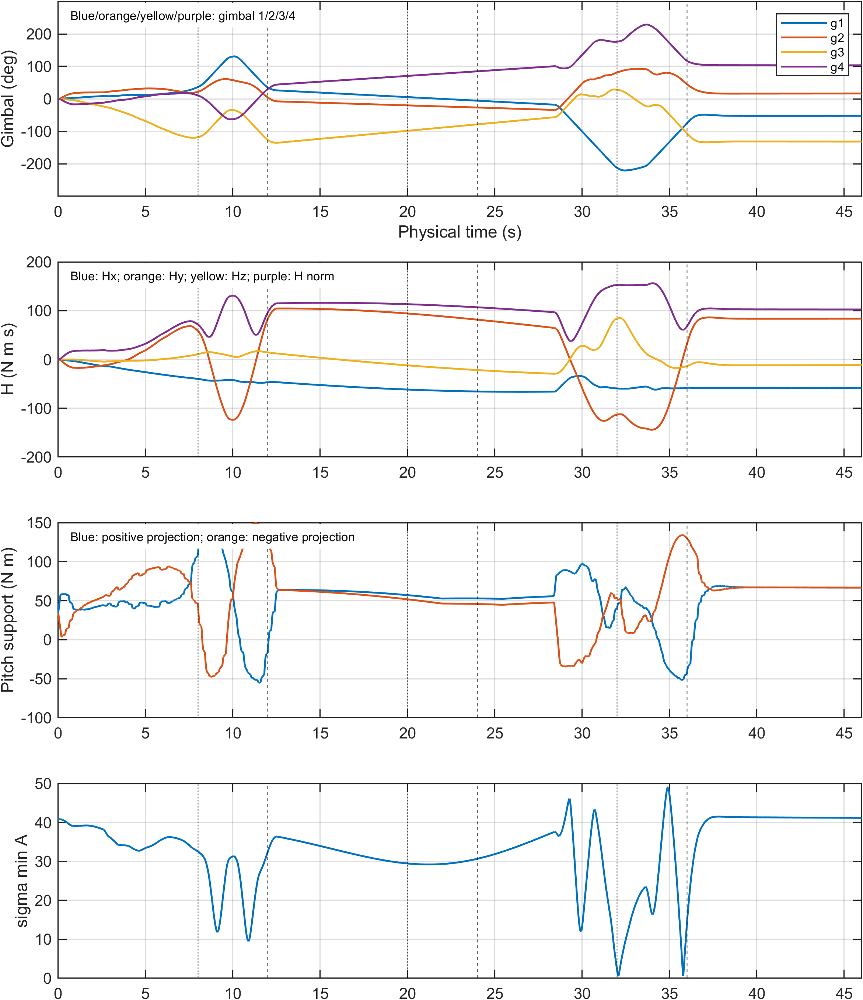
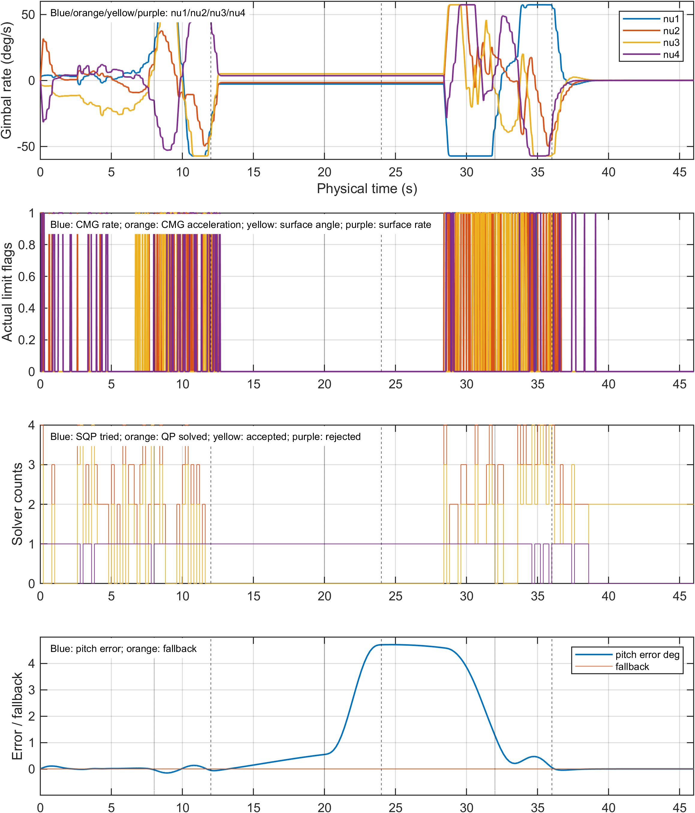

# C2 第二次退化诊断

本阶段新增仿真0次。唯一精确统计来源为旧批次 `simulink/results/paper_experiments/20261105_redesign_v1/E2/cases/V2_C2_3/sim_output.mat`，共60001个1ms样本；优化日志来自同目录 `NearSpace_CMG_FlightControl_V2_C2_3_authority.mat`。未以20ms派生CSV替代原始状态。

## 事件级复核

|机动|机动RMSE(°)|机动后RMSE(°)|后段观测(s)|前H模(Nms)|前Hy(Nms)|前sigma_min|正/负俯仰支撑(Nm)|
|---:|---:|---:|---:|---:|---:|---:|---|
|1|0.106868|0.369535|8|76.006|64.586|33.116|99.037/51.144|
|2|3.232611|4.626222|8|113.505|94.771|29.555|57.571/52.328|
|3|0.557230|0.023094|10|151.751|-115.617|9.118|24.172/58.725|

前置状态取onset−0.2s；事件RMSE沿用旧口径（机动两端包含，后段在下一事件前结束）。前两次后段均只有8s，不冒充完整10s。7段时间线统计采用左闭右开，最后一段包含46s，因边界单样本口径会与事件表略有差异，历史文件不修改。

## 四个问题的证据回答

1. **第一次后的构型和方向角动量发生变化，未发生所谓“电量耗尽”。** 7.8s的Hy=64.586Nms，12s为83.018Nms，19.8s为94.771Nms；机动前H模从76.006增至113.505Nms。正向单步投影支撑由99.037降至57.571Nm，负向约51.144→52.328Nm，具有方向性，不能用H模代替剩余控制能力。第三次前sigma_min更低且正向支撑更低，但跟踪更好，单一奇异值/静态支撑解释不足。

2. **第二次之前已发生优化停滞，第二次期间缺少有效新动作。** 12–20s共40次上层控制、20–24s共20次，所有QP状态成功、无回退，但每次第一全步均以`objective_increase`拒绝，接受步数均为0。20s前俯仰已落后0.547°，24s落后4.705°；20–24s实际俯仰角速度接近零而参考在增加。CMG俯仰力矩仅约2.679–3.576Nm，实际气动力矩约−1.730Nm，实际与气动指令差RMS仅0.002016Nm，四类执行器饱和比例均为0。该段没有证据表明是舵面/框架撞限导致指令不能兑现。

这支持“求解成功但提议全步未被接受，沿用可行名义/移位动作导致跟踪退化”的近端解释。**尚不能判定**拒步究竟由局部线性化、非线性目标曲率、移位名义轨迹、长时域任务折衷或全步策略中的哪一项主导。不能因为局部投影支撑为正，就断言完整三轴与全时域任务必然可行；也不能把QP成功等同于控制改进。没有修改MPC来验证有利解释。

3. **24–32s确实持续迁移并纠正误差，但尚不能证实“专门主动恢复构型”。** Hy从81.570变为−112.981Nms，框架持续运动，该段速率/加速度饱和比例约23.625%/27.738%；直到28.4s才重新出现接受步。随后实际力矩产生了与纠偏对应的角加速度，俯仰在32s前追近参考。日志显示的是跟踪控制与构型变化共存，不能据此区分“以恢复构型为目的”与“为纠正当前/未来跟踪误差而自然发生的构型迁移”。

4. **第三次改善的直接可见因素是优化重新产生接受动作、机体已具有正俯仰角速度，而非正向支撑变大。** 31.8s实际q≈0.023608rad/s（1.353°/s），32s已在向上追踪；32–36s成功QP55次、接受38步、拒绝17步，实际CMG力矩范围约−131.845至36.328Nm，具有明显加速/制动作用。与第二次的0接受步、近零角速度形成对比。第三次前正向支撑24.172Nm小于第二次57.571Nm，负向支撑58.725Nm稍大；单一瞬时支撑不能排序整个机动性能。能确认状态和动作时间线改善，不能唯一分解优化恢复、既有角速度和构型变化各自的因果贡献。

## 动力学与环境口径

气动实际力矩包含自然气动力矩与舵面增量，图中另列自然项，避免重复相加。原生物理模型满足 `J*omega_dot = tau_aero + tau_CMG + tau_d - omega×H - omega×(J*omega)`。总控制力矩不是角加速度；俯仰体轴角速度也不是所有姿态下的欧拉俯仰角导数。原始四框架角、真实速率/加速度、三轴H、真实舵偏/舵速均参与统计。支撑是带速率/加速度约束的单步方向投影上界，不是另外两轴为零时的纯俯仰力矩。

附图额外叠加参考角速度差分得到的角加速度力矩代理：`J*omega_ref_dot - tau_d + omega×H + omega×Jomega`，在测得的旋转状态下估算。第二次该代理约−213.27至212.05Nm，实际控制力矩对它的差RMS约153.12Nm；因此不能忽略快速参考本身的动态需求和局部权限约束。但这是含时间插值/差分的条件前馈代理，不是MPC真实请求，也不含姿态反馈；不能由某个局部投影上界独立判定全时域不可行。三次参考加速度需求接近，而优化接受动作与初始角速度差异明显，仍不能将第二次唯一归因于静态权限。见[C2参考力矩代理分段表](../tables/C2_required_torque_segments.csv)。

动压随飞行由高变低，第二次约20s处为3.179Pa，第三次约32s为1.416Pa；高度、速度、迎角随时间变化，详见7段表和边界状态表。第三次环境气动权限更低但跟踪更好，不能把全部差异归因于动压。

最小补充诊断建议：仅离线回放19.8/20.0/28.4s附近的完整名义X/U、提议X/U、非线性目标前后值和独立约束复核结果，并区分首次全步与名义移位；不先改权重、SQP次数或控制器。现存日志缺少足够的提议轨迹/逐项目标信息，不编造不存在字段。

## 图表与来源

[7段精确统计](../tables/C2_segment_metrics.csv)；[各执行器分段饱和比例](../tables/C2_per_actuator_segment_saturation.csv)；[事件边界状态](../tables/C2_event_boundary_states.csv)；[3次机动复算](../tables/C2_3maneuvers_recomputed.csv)；[真实求解日志](../tables/C2_solver_diagnostics.csv)。
