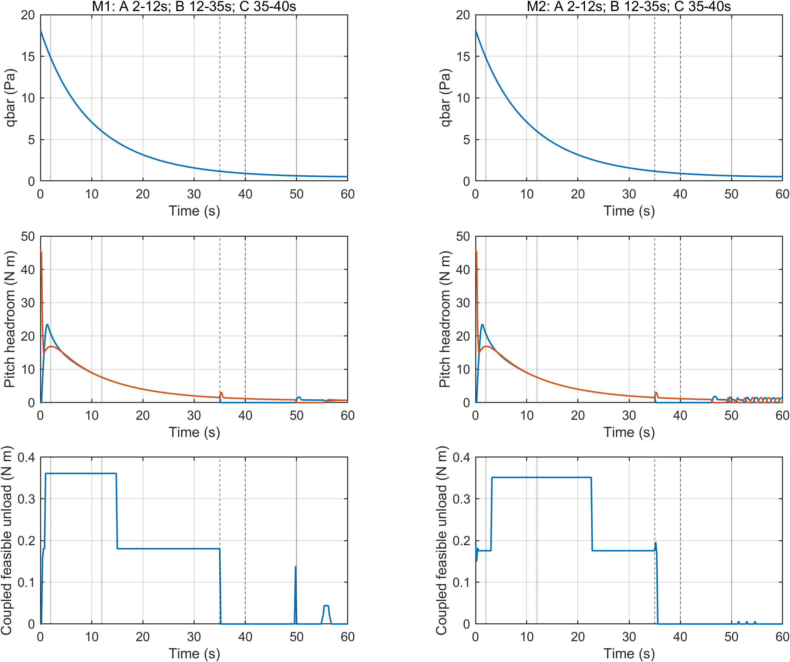
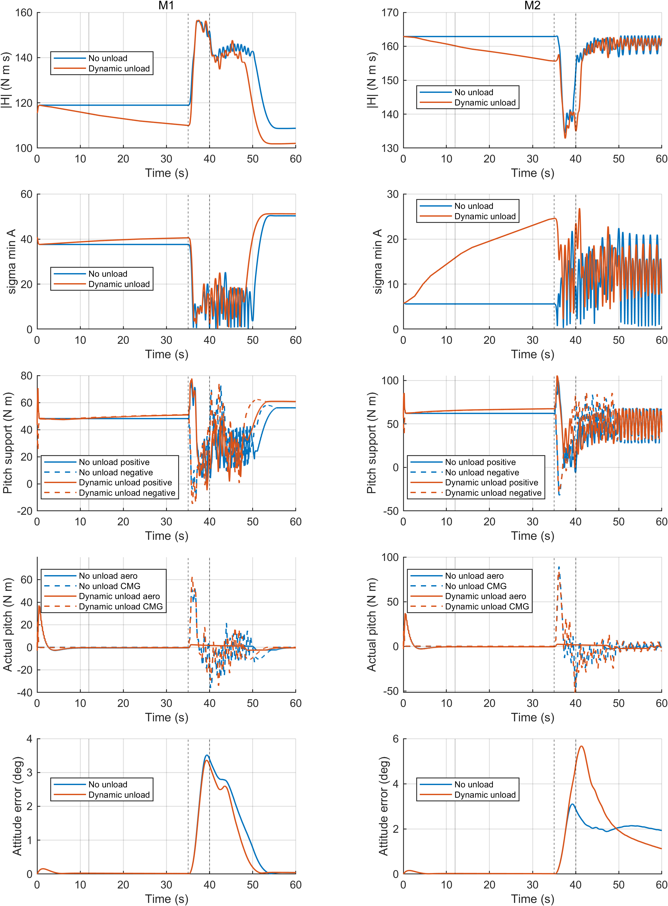
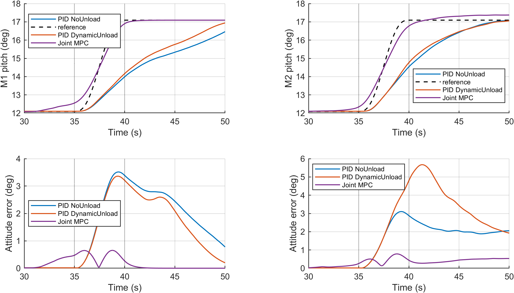

# 实验二修订综合结论

本次完成C2原始MAT只读诊断（新增0次），M1/M2动态卸载非正式预检2次，正式六自由度仿真6次。实验一/三/四冻结。

## C2证据链

12–24s共60个QP求解成功但全步因objective_increase拒绝、接受步为0；第二次机动期间无执行器饱和且气动力矩跟随指令，因而优化停滞是直接可见证据。第三次前Hy已改变符号且机体有正俯仰角速度，优化又产生接受动作。不能归因为角动量电量耗尽，也不能唯一断言是主动构型恢复。详细证据、动力学项和未决原因见[C2诊断](C2_第二次退化诊断.md)。

## 真实窗口与实现

采用原生轨迹A=2–12s、B=12–35s、C=35–40s，机动后完整观测40–50s，运行至60s。窗口来自真实动压、飞行状态与耦合舵面补偿候选；控制执行不按秒数强制增减，不冻结物理状态。详见[场景可行性](M1M2_场景可行性.md)。

冻结PID原文件未改。两PID使用同一实验副本，只差unload开关，kp/ki/kd和基础链式分配一致。取消2Nm固定卸载cap与0.2Nm额外slew，按物理框架速率/加速度可行射线和三轴舵面分配、真实20ms舵面/CMG驱动预测选最大可行程度；hon/hoff=80/60、残差门2Nm、qmin=1、补偿容差0.25Nm均保持。不存在用更大常数替代旧上限。MPC目标/权重、23.2s时域和最多4轮SQP不变。

## 正式结果

|构型|方法|状态|机动RMSE(°)|机动后10s RMSE(°)|34.8s H模(Nms)|34.8s正/负俯仰支撑(Nm)|
|---|---|---|---:|---:|---:|---|
|M1|PID_NoUnload|TRACKING_FAIL|2.288939|2.348221|118.944537|48.1730 / 48.1730|
|M1|PID_DynamicUnload|TRACKING_FAIL|2.194236|2.030444|110.026964|50.8816 / 51.1113|
|M1|MPC|SUCCESS|0.500145|0.050422|110.700122|56.7911 / 12.5847|
|M2|PID_NoUnload|TRACKING_FAIL|2.030638|2.134792|162.881871|62.1591 / 62.1591|
|M2|PID_DynamicUnload|TRACKING_FAIL|2.515378|3.847160|155.669338|67.4843 / 67.4707|
|M2|MPC|SUCCESS|0.516915|0.430552|160.255689|93.5485 / 4.6020|

动态卸载对比（正误差改善值表示误差降低）：

- M1：机动前相对无卸载H模降低 8.917572 Nms；机动RMSE改善 0.094704°，后10s RMSE改善 0.317777°；有效卸载174步，最大选用额外力矩 0.377296 Nm，实际20ms条件增量补偿最大误差 0.176760 Nm。
- M2：机动前相对无卸载H模降低 7.212534 Nms；机动RMSE改善 -0.484741°，后10s RMSE改善 -1.712368°；有效卸载179步，最大选用额外力矩 0.444501 Nm，实际20ms条件增量补偿最大误差 0.157987 Nm。

## 验收与解释限制

六例完成=1，物理/采样检查=1，预测H相对同刻基础动作严格下降=1，实际条件端点补偿在原容差内=1。性能失败完整保留；执行/数据验收通过不等于姿态稳定判据通过。两次16s预检的旧分析状态保留TRACKING_FAIL（未观测35s之后的正式机动），其通过项仅为预先声明的保持/补偿/物理安全检查。

实际附加力矩由真实20ms输出相对“同一时刻无卸载条件端点”计算，抵消同态自然气动力矩；它不是第二条反事实飞行轨迹。后续轨迹收益使用六次独立正式仿真的配对比较，不以指令理论相消代替物理补偿。

删除固定cap并不保证大卸载量；实际幅值仍受20ms舵机/CMG动态、三轴耦合和原0.25Nm补偿容差约束。H模下降不自动意味着所有方向权限增加，方向支撑仍只是单步投影上界，不是纯俯仰三轴独立可达力矩。若后续误差没有改善或未过稳定判据，不宣称显著卸载收益或稳定性得到证明。

[六例汇总](../tables/M1M2_6cases.csv)；[A/B/C阶段统计](../tables/M1M2_stage_metrics.csv)；[配对结果](../tables/M1M2_paired_results.csv)；[验收状态](E2_acceptance.json)。原始数据位于本批次E2/cases/E2R_M1_1等六个目录的sim_output.mat；两份预检位于E2_PRECHECK/cases。
