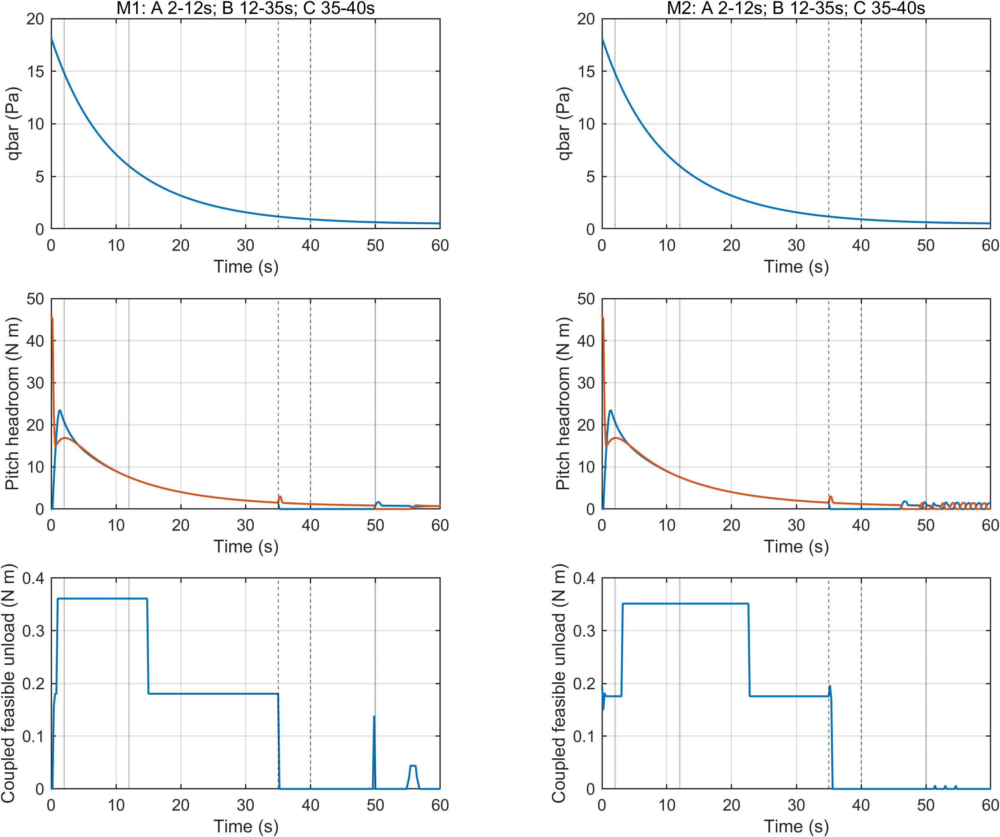

# M1/M2 场景物理可行性

## 轨迹与不可变物理条件

采用旧M1/M2无卸载案例的真实六自由度轨迹作为条件评估依据，未手工指定动压、修改高度/速度关系或气动参数。新案例沿用相同原生初态：高度 89748.7373415 m，NED速度 [3570.03318597;312.337432184;-637.893705484] m/s；原生环境/气动极线、质量/惯量、舵面及CMG物理参数全部不变。机体初始姿态/角速度和扰动来自同一归档bank，完整逐量条件见source bank和新case_config/build_config。M1框架角[pi/2,pi/2,0,0]、M2框架角[1.5,1.5,1.5,1.5] rad。

## 由真实状态支持的A/B/C

A=2–12s，B=12–35s，C机动=35–40s（+5°、5s过渡），机动后完整观测40–50s，实际运行至60s。A/B只是对真实状态的日志分段，控制器没有按这些秒数增力矩、停机或冻结CMG。动态执行由实际权限、基础残差、物理约束与补偿可行性决定。

|构型|A动压范围(Pa)|B动压范围(Pa)|C动压范围(Pa)|A可行控制步|A/B平均可行额外力矩范数(Nm)|
|---|---|---|---|---:|---|
|M1|6.0960–14.8363|1.2086–5.9946|0.9340–1.1957|50/50|0.361030 / 0.204061|
|M2|6.0960–14.8363|1.2086–5.9946|0.9340–1.1957|50/50|0.330369 / 0.258244|

离线门控通过=1。补偿候选使用完整三轴B矩阵和真实舵偏区间分配，不使用独立三轴力矩盒；同时通过20ms F20反馈分配、1ms舵机递推和CMG驱动递推。方向投影余量仅用于图示，不作为耦合可行性证明。qbar≥1Pa仅保留旧配置的粗停止门，绝不当作“足够卸载”的判据。

## 本结论的边界与正式仿真前门控

以上证明的是旧无卸载轨迹上逐时刻局部可行性，尚不等价于动态卸载闭环轨迹必然安全或有收益。正式六例之前只做M1/M2各一例16s动态卸载非正式预检：验证原物理限幅、已有1°姿态保护、严格预测H下降、已有0.25Nm补偿容差，以及20ms实际增量对条件无卸载端点的补偿误差。任何预检不通过即停止正式六例，不放宽容差制造通过。

卸载不再使用旧2Nm固定上限或0.2Nm每周期额外力矩slew。最大候选来自实际框架速率/加速度区间中的H下降方向射线，再按1,1/2,...,1/4096线搜索第一个可行点；基础PID kp/ki/kd、hon=80/hoff=60、qmin=1、残差门2Nm、补偿容差0.25Nm及全部物理约束保持不变。旧kh字段不作为固定力矩幅值限制，下降方向由H梯度决定。即使删去2Nm上限，20ms补偿和驱动动态仍可能把可行卸载限制在很小幅值，不能预设卸载显著。

[离线逐控制步证据](../tables/M1M2_offline_feasibility.csv)；参数与门控见config/scenario_offline.json和scenario_feasibility_gate.json；闭环预检结果见precheck_acceptance.json。
