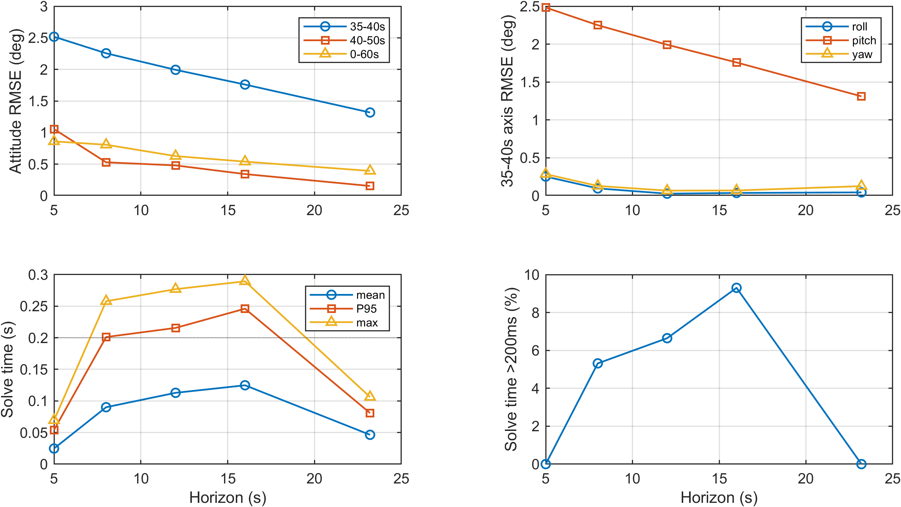
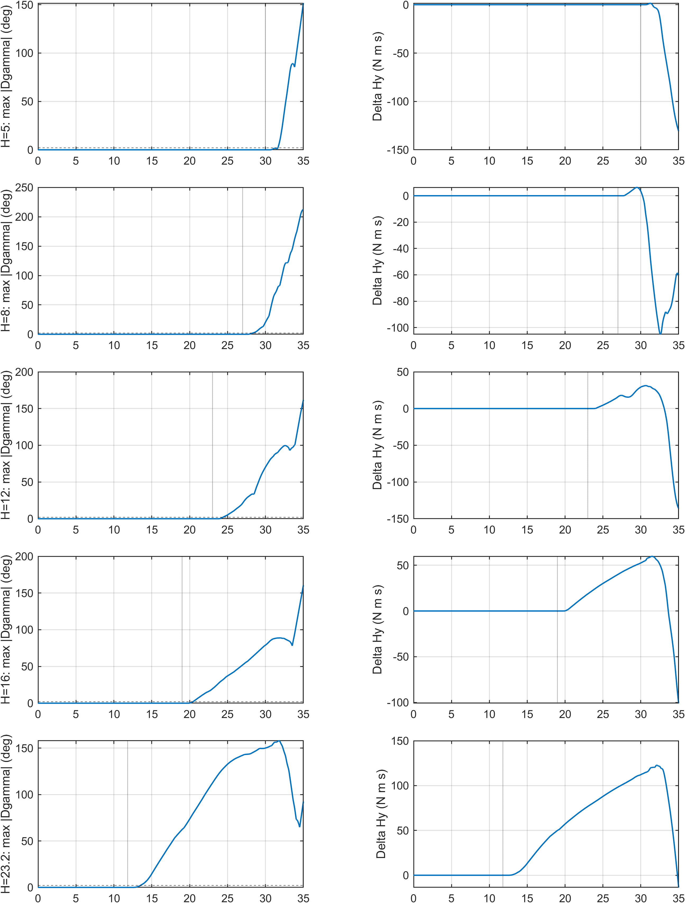
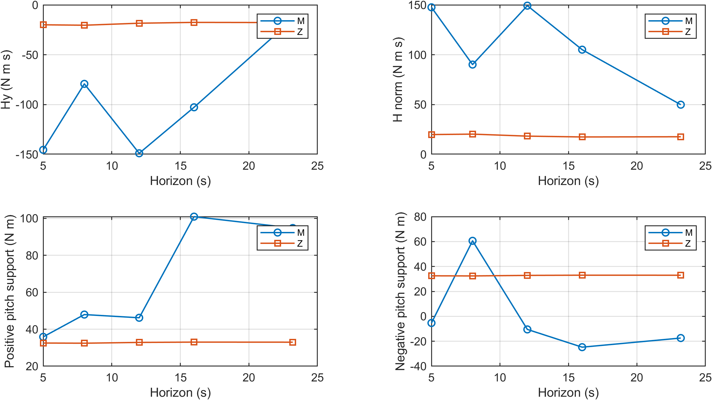

# 实验三：五档预测时域×有/无机动

最终10例，新增7次真实Simulink闭环仿真，旧S/L/Z三例只读复用。onset=35s，transition=5s，duration=60s；M俯仰增量10°，Z为真实零机动。未混入onset=8s历史协议，未更改物理模型、控制目标/权重或4轮SQP上限。

主迁移判据为同H的M−Z最大框架角差严格超过2°、持续至少0.6s、且完整持续段在35s前。首次时刻取跨阈值起点；未发生者保留NaN；0.5°和5°仅做敏感性分析。绝对10°迁移受共同启动瞬态影响，仅为诊断。

|H(s)|35–40s姿态RMSE(°)|40–50s RMSE(°)|迁移时刻(s)|提前量(s)|预览前最大角差(°)|预置证据|
|---:|---:|---:|---:|---:|---:|---|
|5.0|2.517184|1.055252|31.643|3.357|0|1|
|8.0|2.255163|0.529604|28.322|6.678|0|1|
|12.0|1.993398|0.480144|24.397|10.603|0|1|
|16.0|1.760107|0.343025|20.440|14.560|0|1|
|23.2|1.317855|0.154632|13.490|21.510|0|1|

预览前一致性全部通过：1。若不通过，不能将差异归因为任务预置；应先排查同时间参考、初态、扰动和控制器一致性。Z只报告10–35s保持误差，不参与机动排名。三轴RMSE和峰值由完整1ms物理输出独立重算；几何姿态误差、准备段有效反向力矩样本数、求解耗时和回退等沿用原分析口径。

方向控制权限取34.8s的真实状态，沿用v3_analyze速率/加速度约束算法。这只是方向投影上界，不等于另两轴力矩为零的纯俯仰可达力矩；Hy更大不必然更好。正负支撑可为负值，表示该加速度受限瞬时可达集合在该方向上的有符号支撑。sigma_min、Hy、H模和正负支撑均保留。

执行配合仅统计准备段两种实际俯仰力矩绝对值均大于1Nm的样本；反向比例必须结合样本数和姿态保持误差，不能单独称为完美补偿。不同预测网格的差异也不能全部归因为提前迁移。真实失败、模型越界和未迁移情况全部保留在表与验收来源中。

[10例完整指标](../tables/E3_10cases.csv)；[5组配对指标](../tables/E3_5pairs.csv)；[验收来源](E3_acceptance.json)。

求解耗时包含真实离线运行开销，8/12/16s部分控制步超过200ms；未由这些结果证明硬实时能力。5s/23.2s有机动数据来自旧运行，其他时域为新运行，运行负载和启动开销可能不同，因此耗时的非单调差异不能全部归因为预测时域。该限制不改变同时间物理轨迹的配对分析。
