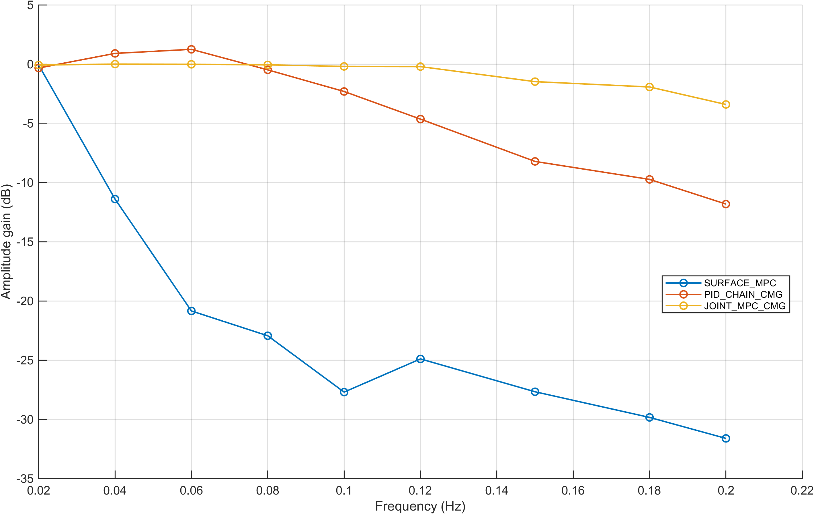
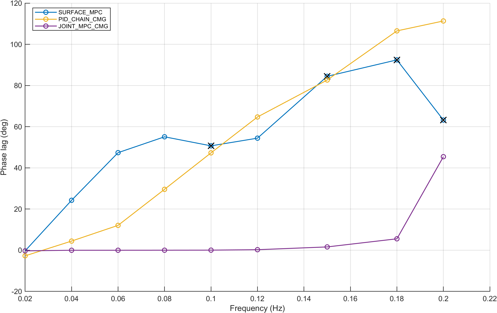
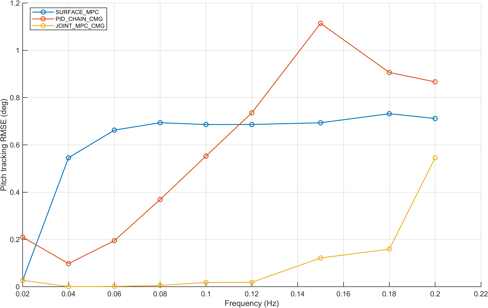

# 实验四：固定1°峰值周期跟踪

只读复用旧批次27例（3方法×9频率），新增仿真0次。3°/5°的54例保持归档。各频率运行8+4/f秒，最后两周期分析。

三条核心曲线分别展示幅值增益、相位滞后、直接俯仰跟踪RMSE。正相位表示滞后，增益比低于0.05的相位用黑色叉号标记，不作为可靠相位解释。

辅助工程通过数：仅舵面MPC 1/9、冻结PID+CMG 4/9、联合MPC 8/9；判据沿用增益≥−3dB、|相位|≤45°、RMSE≤0.5°，不能代替连续曲线。

不同频率对应不同飞行时长、高度和动压，结果不是严格固定工作点LTI频率响应，不能直接推断带宽倍数。没有重整PID、修改控制器或重跑仿真。完整表保留失败和较差跟踪状态、拟合残差、偏差、趋势、动压/高度、执行器饱和、耗时与回退。

数据：[27例完整表](../tables/E4_1deg_27cases.csv)；来源与验收：[E4_acceptance.json](E4_acceptance.json)。
