# 第四章 实验结果与分析

## 4.1 实验目的与对比设计

本章通过多组姿态机动仿真，评价气动舵面与控制力矩陀螺（CMG）联合控制方案的闭环效果，并进一步分析预测时域中未来机动信息对 CMG 构型迁移的影响。实验分为两部分：第一部分采用 A/B 对照，比较不使用 CMG 的气动舵面控制（A）与舵面–CMG 联合控制（B）；第二部分采用 A/B/C 对照，考察完整预测时域、短预测时域和不包含未来机动参考时的构型变化差异。

A/B 对照包含 P0 和 P1 两类执行器模型。P0 为理想等效力矩模型，主要用于分析联合控制策略本身对姿态跟踪、力矩分配、CMG 角动量及框架运动的影响；P1 为包含真实舵面执行器环节的模型，用于检验引入舵面执行动态后，联合控制效果是否仍然成立。两类模型的结果分别统计，不将 P0 的理想执行器结果替代 P1 的真实执行器验证。

A/B/C 对照则围绕未来机动参考是否进入预测窗口展开：A 使用完整预测时域（23.2 s），B 使用短预测时域（5.0 s），C 的预测窗口不包含未来机动参考。该组实验重点观察机动发生前的框架角变化、角动量演化和姿态误差，而不是将三种配置简单视为控制性能排名。

## 4.2 实验场景与评价指标

### 4.2.1 A/B 姿态机动场景

P0 共设置八组任务，覆盖单轴正向与反向俯仰、不同幅值俯仰、滚转、偏航、俯仰–滚转耦合以及连续机动。各任务均在相同场景下比较 A 与 B。图中以 \(t=110\,\mathrm{s}\) 标记主机动开始时刻，以 \(t=130\,\mathrm{s}\) 标记主机动结束时刻；图中还标出了 CMG 构型迁移开始和气动控制缺口出现的时刻。连续机动任务的仿真时间延长至 170 s。

P1 选取三组代表性任务：正向俯仰 \(30^\circ\)、反向俯仰 \(-30^\circ\) 和俯仰 \(30^\circ\)–滚转 \(20^\circ\) 耦合机动。该组实验保留 A/B 对照关系，但将舵面执行器动态纳入被控对象，因而可用于检查 P0 结果是否过度依赖理想舵面力矩假设。

### 4.2.2 评价指标

实验从姿态跟踪、执行器力矩、CMG 构型与角动量、计算开销四个方面进行评价。

姿态跟踪采用图中给出的主机动窗口姿态误差 RMSE 和峰值误差。需要注意，图中“短暂姿态误差”曲线反映整个仿真期间误差随时间的变化，而图例中的 RMSE 和峰值对应主机动窗口，二者统计范围不同。

执行器力矩部分比较参考需求力矩、气动舵面力矩、CMG 力矩以及合成力矩。气动舵面可实现力矩范围用于判断当前需求是否超出舵面能力；CMG 输出力矩则用于观察联合控制是否补偿了气动控制缺口。

CMG 状态部分记录四个框架角及其角速度、集群角动量分量和角动量模长。角动量用于描述 CMG 集群的内部状态，瞬时力矩则由当前构型下的力矩雅可比矩阵与框架角速度共同决定，两者不能混为同一指标。

计算开销采用图中记录的求解耗时曲线，并以 \(200\,\mathrm{ms}\) 控制周期作为参考线。求解耗时低于控制周期仅表示该采样点的求解时间满足周期预算；若存在超周期样本，则仍不能据此认定系统已满足硬实时要求。

## 4.3 P0 理想力矩模型下的 A/B 对比实验

### 4.3.1 不同俯仰机动

图4-1和图4-2分别给出 \(+30^\circ\) 与 \(-30^\circ\) 俯仰机动下的 A/B 对比结果。

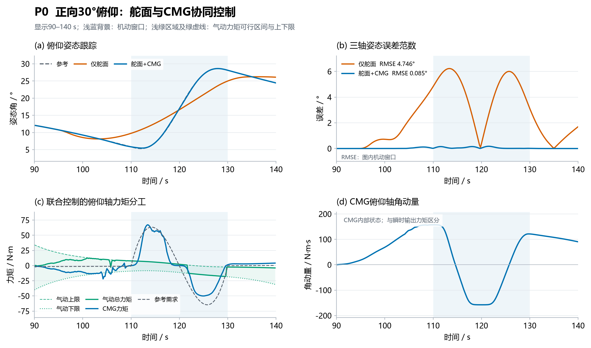

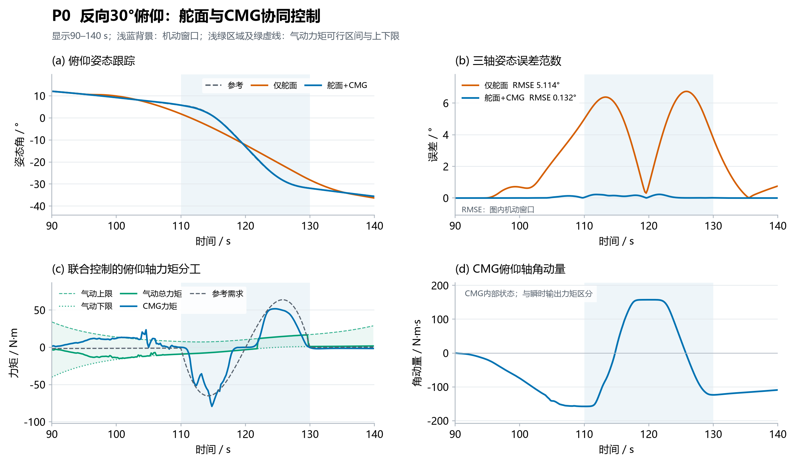

在 \(+30^\circ\) 俯仰任务中，A 组主机动窗口姿态误差 RMSE 为 \(4.746^\circ\)，峰值为 \(6.22^\circ\)；B 组 RMSE 降至 \(0.085^\circ\)，峰值为 \(3.77^\circ\)。从误差曲线看，B 组在主机动期间能够较好地跟踪参考姿态，而 A 组出现明显的误差积累。力矩曲线显示，主机动期间 CMG 输出参与补偿俯仰轴需求，联合控制的合成力矩更接近参考需求。

在 \(-30^\circ\) 俯仰任务中，A 组 RMSE 为 \(5.114^\circ\)，峰值为 \(6.74^\circ\)；B 组 RMSE 为 \(0.132^\circ\)，峰值为 \(0.23^\circ\)。正、反两个方向的实验均显示，加入 CMG 后主机动窗口内的姿态跟踪误差明显降低，说明该效果并非仅出现在单一俯仰方向。

### 4.3.2 不同幅值俯仰机动

图4-3和图4-4分别给出 \(10^\circ\) 与 \(45^\circ\) 俯仰机动结果。

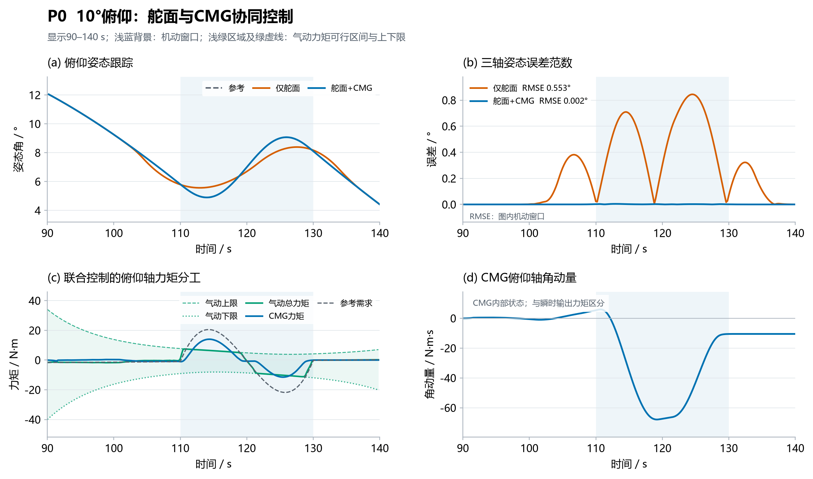

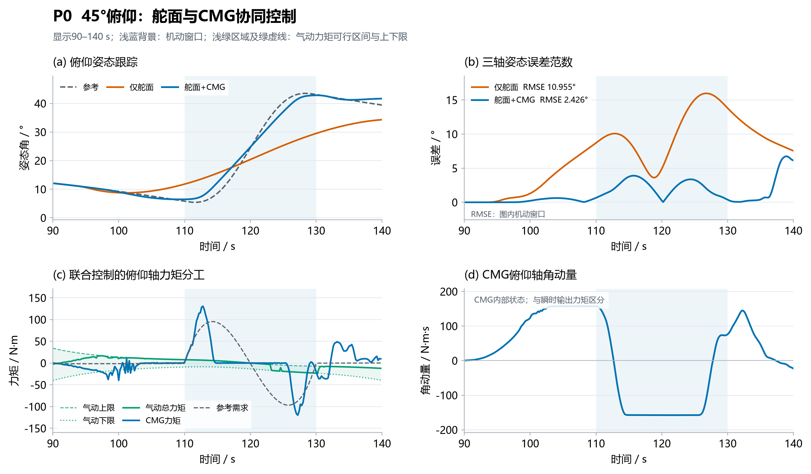

在 \(10^\circ\) 小幅值俯仰任务中，A 组 RMSE 为 \(0.553^\circ\)，峰值为 \(0.84^\circ\)；B 组 RMSE 约为 \(0.002^\circ\)，峰值在图示精度下接近 \(0^\circ\)。该工况下两种控制方案均能完成基本跟踪，但 B 组误差进一步减小，说明联合控制在较小机动需求下没有表现出明显的跟踪劣化。

在 \(45^\circ\) 大幅值俯仰任务中，A 组 RMSE 为 \(10.955^\circ\)，B 组 RMSE 为 \(2.426^\circ\)。B 组在主机动阶段的姿态跟踪误差明显低于 A 组。图中 B 组在仿真末尾出现的误差上升属于机动结束后的尾段发散，不作为本组主机动跟踪性能的评价依据。因此，本场景以主机动窗口 RMSE 作为主要比较指标。

### 4.3.3 滚转与偏航机动

图4-5和图4-6分别给出滚转 \(30^\circ\) 与偏航 \(30^\circ\) 机动结果。

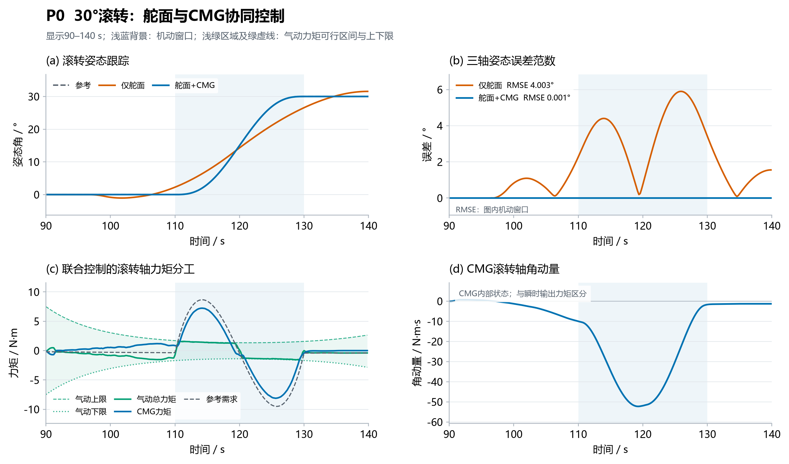

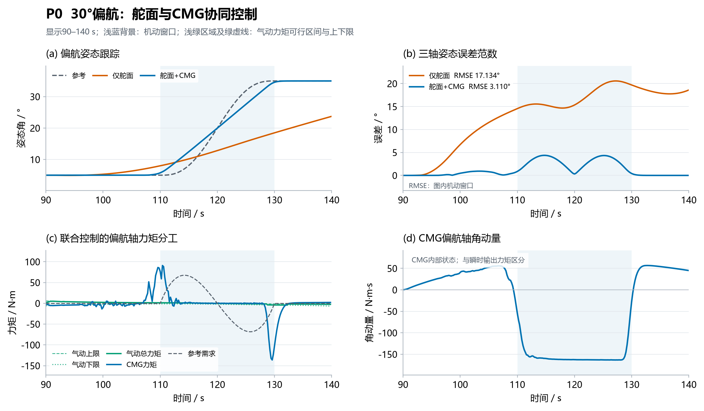

滚转 \(30^\circ\) 任务中，A 组 RMSE 为 \(4.003^\circ\)，峰值为 \(5.90^\circ\)；B 组 RMSE 约为 \(0.001^\circ\)，峰值在图示精度下接近 \(0^\circ\)。联合控制显著减小了滚转跟踪误差，且 CMG 力矩主要体现在滚转轴方向。

偏航 \(30^\circ\) 任务中，A 组 RMSE 为 \(17.134^\circ\)，峰值为 \(34.61^\circ\)；B 组 RMSE 为 \(3.110^\circ\)，峰值为 \(4.37^\circ\)。相较于 A 组，B 组在整体误差和峰值误差上均有明显改善。该结果说明，在当前模型和约束设置下，CMG 不仅能够参与俯仰控制，也能够在偏航机动中提供有效的补充控制力矩。

### 4.3.4 多轴耦合与连续机动

图4-7为俯仰 \(30^\circ\) 与滚转 \(20^\circ\) 耦合机动，图4-8为连续机动任务。

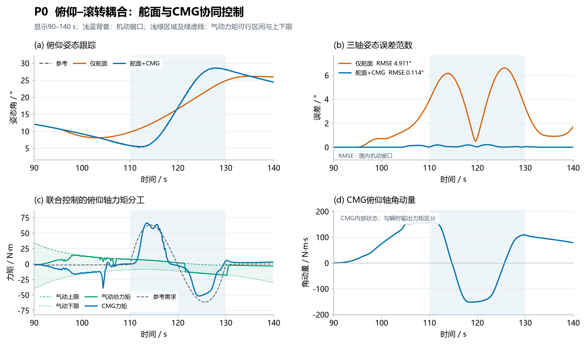

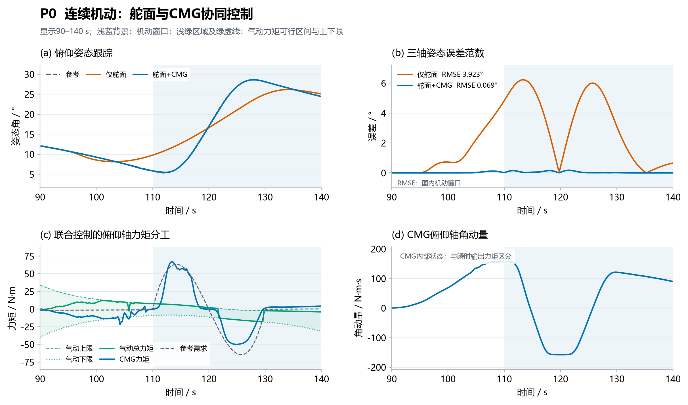

在俯仰–滚转耦合任务中，A 组 RMSE 为 \(4.911^\circ\)，峰值为 \(16.30^\circ\)；B 组 RMSE 为 \(0.114^\circ\)，峰值为 \(1.44^\circ\)。误差分量曲线显示，A 组在多个姿态轴上均出现偏差，而 B 组各轴误差整体保持较小，说明 CMG 的补充控制作用并不局限于单轴机动。

在连续机动任务中，A 组 RMSE 为 \(2.802^\circ\)，峰值为 \(6.22^\circ\)；B 组 RMSE 为 \(0.049^\circ\)，峰值为 \(0.17^\circ\)。B 组在连续参考变化过程中保持了较小的姿态误差。力矩和角动量曲线同时表明，CMG 在不同机动阶段调整框架状态和输出力矩，联合控制能够在连续任务中协调舵面与 CMG 的力矩贡献。

### 4.3.5 P0 实验结果汇总

**表4-1 P0 模型下各姿态机动任务的主机动窗口 RMSE**

| 场景 | A组 RMSE / ° | B组 RMSE / ° |
|---|---:|---:|
| 俯仰 +30° | 4.746 | 0.085 |
| 俯仰 −30° | 5.114 | 0.132 |
| 俯仰 +10° | 0.553 | 0.002 |
| 俯仰 +45° | 10.955 | 2.426 |
| 滚转 +30° | 4.003 | 0.001 |
| 偏航 +30° | 17.134 | 3.110 |
| 俯仰 +30°/滚转 +20° | 4.911 | 0.114 |
| 连续机动 | 2.802 | 0.049 |

从八组 P0 场景可以看出，B 组在所有场景中的主机动窗口 RMSE 均低于 A 组，说明在所测试的姿态机动任务中，加入 CMG 后能够有效改善主机动阶段的姿态跟踪精度。对于 \(45^\circ\) 大幅值俯仰场景，仿真末尾的误差发散不属于主机动阶段，因此不纳入上述 RMSE 对比，也不据此评价主机动控制效果。

## 4.4 P1 真实舵面执行器模型下的对比实验

为进一步检查联合控制方法对舵面执行动态的适应性，采用 P1 模型开展三组代表性机动实验。与 P0 理想等效力矩模型不同，P1 将真实舵面执行器环节纳入闭环，因此该组实验能够反映舵面动态对力矩跟踪及 CMG 补偿效果的影响。

### 4.4.1 正向与反向俯仰机动

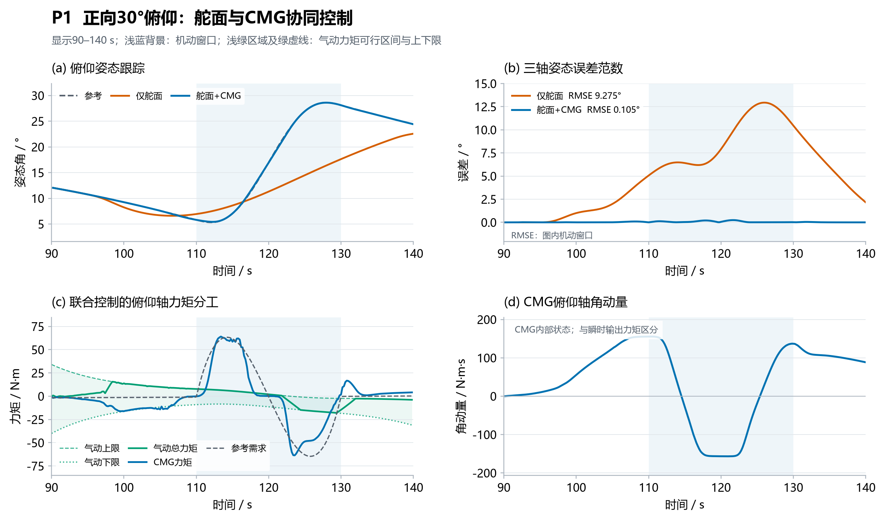

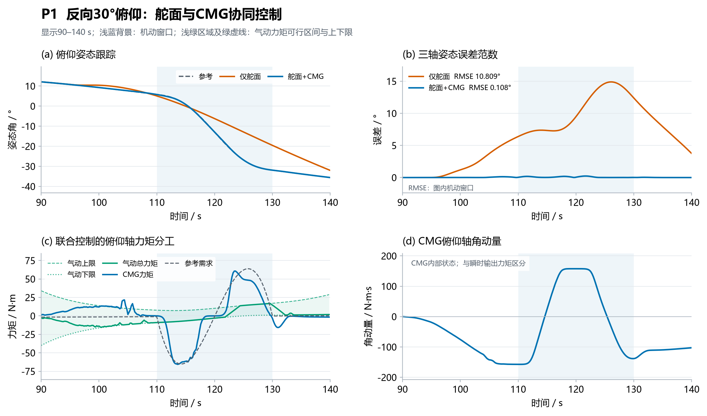

在 \(+30^\circ\) 俯仰机动中，A 组 RMSE 为 \(9.275^\circ\)，峰值为 \(12.94^\circ\)；B 组 RMSE 为 \(0.105^\circ\)，峰值为 \(2.97^\circ\)。相较 P0 同类场景，P1 中 A 组误差进一步增大，而 B 组仍保持较小的姿态跟踪误差，说明在当前执行器动态模型下，CMG 能够补偿部分舵面响应不足所造成的控制误差。

在 \(-30^\circ\) 俯仰机动中，A 组 RMSE 为 \(10.809^\circ\)，峰值为 \(14.89^\circ\)；B 组 RMSE 为 \(0.108^\circ\)，峰值为 \(0.24^\circ\)。正、反向俯仰结果具有一致趋势：引入 CMG 后，主机动期间的姿态误差显著降低。

### 4.4.2 俯仰–滚转耦合机动

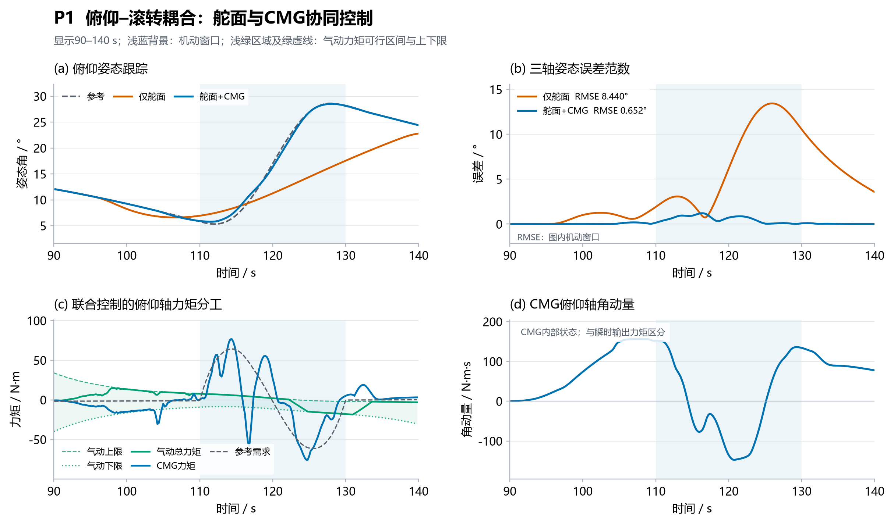

在俯仰 \(30^\circ\)–滚转 \(20^\circ\) 耦合机动中，A 组 RMSE 为 \(8.440^\circ\)，峰值为 \(13.44^\circ\)；B 组 RMSE 为 \(0.652^\circ\)，峰值为 \(2.26^\circ\)。B 组在多轴耦合情况下仍能保持较小误差，说明联合控制的改善效果并非仅存在于单轴俯仰任务。

### 4.4.3 P1 实验结果汇总

**表4-2 P1 模型下各姿态机动任务的主机动窗口误差**

| 场景 | A组 RMSE / ° | A组峰值 / ° | B组 RMSE / ° | B组峰值 / ° |
|---|---:|---:|---:|---:|
| 俯仰 +30° | 9.275 | 12.94 | 0.105 | 2.97 |
| 俯仰 −30° | 10.809 | 14.89 | 0.108 | 0.24 |
| 俯仰 +30°/滚转 +20° | 8.440 | 13.44 | 0.652 | 2.26 |

P1 三组实验中，B 组的 RMSE 和峰值误差均低于 A 组。尤其在正、反向俯仰任务中，B 组 RMSE 均约为 \(0.1^\circ\)，而 A 组超过 \(9^\circ\)。这说明在纳入舵面执行器动态后，CMG 对姿态跟踪仍具有明显的补偿作用。需要指出，当前 P1 仅覆盖三组代表性场景，尚不能据此推断所有机动工况下均具有相同改善幅度。

## 4.5 未来机动信息对 CMG 构型迁移的影响

### 4.5.1 三种预测配置

为分析机动前的 CMG 构型迁移是否受到预测窗口内未来参考信息的影响，设置以下三种配置：

- **A：完整预测时域。** 预测时域为 \(23.2\,\mathrm{s}\)，包含未来俯仰机动参考。
- **B：短预测时域。** 预测时域为 \(5.0\,\mathrm{s}\)，不包含未来机动参考。
- **C：无未来机动参考。** 预测窗口内不提供后续机动参考，用于观察缺少未来机动信息时的姿态与构型演化。

三组实验均以 \(t=110\,\mathrm{s}\) 作为未来机动开始时刻。A 组图中标记的构型迁移起点约为 \(92.8\,\mathrm{s}\)；B 组短时域配置的迁移起点约为 \(108.6\,\mathrm{s}\)，且短预测窗口首次进入机动参考的时刻约为 \(105\,\mathrm{s}\)；C 组没有标记机动前构型迁移起点。

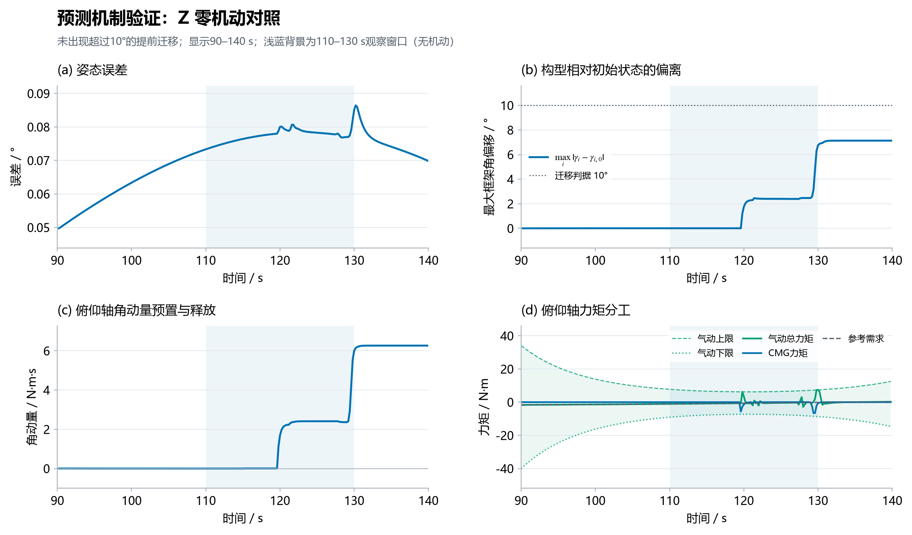

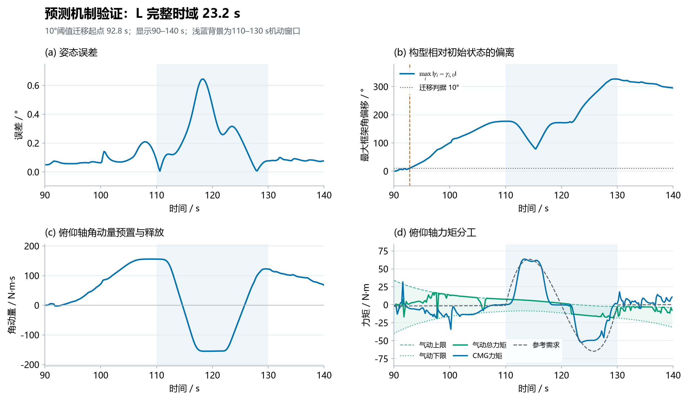

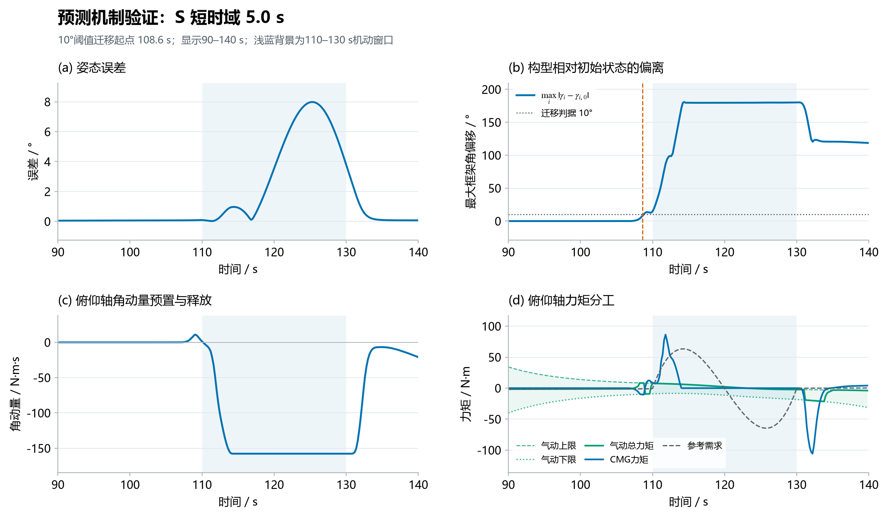

### 4.5.2 构型迁移时刻与角动量演化

A 组在机动开始前较长时间内即出现框架角变化，构型迁移起点约为 \(92.8\,\mathrm{s}\)，比机动开始提前约 \(17.2\,\mathrm{s}\)。在此过程中，俯仰轴角动量 \(H_y\) 逐渐变化，并在机动开始前形成明显的预置状态。主机动发生后，CMG 通过框架角速度变化调节角动量，并输出相应的俯仰轴控制力矩。

B 组的预测时域缩短为 \(5.0\,\mathrm{s}\)，构型迁移起点推迟至约 \(108.6\,\mathrm{s}\)，距离机动开始仅约 \(1.4\,\mathrm{s}\)。其角动量变化主要集中在机动临近及机动开始阶段。与 A 组相比，B 组缺少更早的未来参考信息，因而没有形成同等提前量的构型迁移。

C 组预测窗口不包含未来机动参考，图中没有出现与 A 组相同的机动前构型迁移过程。框架角在机动开始前基本保持不变，角动量也没有形成 A 组中明显的提前变化。机动之后出现的框架角变化不能解释为对该未来机动的提前准备。

### 4.5.3 姿态误差与力矩响应

A 组在机动开始前保持较小的姿态误差，同时完成了较早的构型迁移。进入机动阶段后，CMG 输出力矩与舵面力矩共同作用，使合成力矩跟随参考需求变化。

B 组在机动开始前同样保持较小的姿态误差，但其构型调整主要发生在机动临近时。机动开始后，姿态误差明显增大，随后随着 CMG 输出力矩建立而发生变化。C 组则缺少提前构型迁移，其曲线主要反映在没有未来机动参考时的当前任务跟踪情况。

需要强调，A、B、C 三组的差异不仅体现在姿态误差上，更体现在构型迁移的发生时刻及角动量变化时序上。A 组在机动前约 \(17.2\,\mathrm{s}\) 开始迁移，B 组仅提前约 \(1.4\,\mathrm{s}\)，C 组没有观察到对应的机动前迁移。这组结果支持如下判断：预测窗口能够覆盖未来机动参考时，优化器可以更早地调整 CMG 构型；预测时域缩短后，构型调整时机随之推迟；当未来机动参考不可见时，则未观察到相同的提前迁移行为。

不过，若要将该结果作为严格的因果验证，还应确认三组实验除预测时域和未来参考可见性外，其余初始条件、权重、约束和求解配置完全一致。当前图像能够支持对三种配置下闭环行为差异的描述，但不应超出实际控制变量范围作更强的因果结论。

## 4.6 综合讨论

### 4.6.1 CMG 对姿态跟踪的补偿作用

P0 八组实验中，B 组主机动窗口 RMSE 均低于 A 组；P1 三组实验也呈现相同趋势。尤其在偏航机动、多轴耦合机动和连续机动中，CMG 能够提供额外的控制力矩，使联合控制的姿态误差显著降低。这表明在当前仿真条件下，CMG 的引入能够缓解气动舵面控制能力不足对姿态跟踪造成的影响。

但大幅值 \(45^\circ\) 俯仰任务中，B 组 RMSE 虽低于 A 组，峰值误差却更大，说明联合控制仍可能受到构型、框架速率、角动量边界和瞬态力矩分配的共同影响。因此，评价联合控制效果不能只使用单一 RMSE 指标。

### 4.6.2 真实舵面动态的影响

P1 结果显示，加入舵面执行器动态后，无 CMG 的 A 组在三组代表性任务中均出现较大的姿态跟踪误差；B 组仍保持较低误差。这说明 CMG 不仅能够补充理想舵面模型下的控制能力，在考虑舵面执行动态后也能够发挥补偿作用。

不过，P1 实验数量少于 P0，且当前结果主要集中在俯仰和俯仰–滚转耦合场景。后续仍需扩展至滚转、偏航及连续机动，以进一步验证该结论的适用范围。

### 4.6.3 预测时域与提前构型迁移

A/B/C 对照显示，完整预测时域下的构型迁移明显早于短预测时域；当预测窗口不包含未来机动参考时，没有观察到相同的提前迁移行为。这一结果说明，未来参考信息能够影响当前滚动优化决策，构型调整不仅是对当前姿态误差的被动响应，也可以在预测窗口覆盖未来任务时提前发生。

该机制的意义在于，CMG 构型本身决定了后续角动量交换和瞬时力矩能力。通过提前调整构型，控制器可以在机动到来之前改变角动量分布，为后续力矩输出创造不同的初始条件。需要注意，角动量预置并不等价于瞬时力矩能力必然提高，仍需结合力矩包络和实际输出进行判断。

### 4.6.4 求解实时性与工程适用性

各组 A/B 曲线均记录了在线求解耗时，部分时段求解耗时接近或超过 \(200\,\mathrm{ms}\) 控制周期。尤其在构型快速变化、力矩需求较大或机动切换附近，求解耗时可能出现波动。因此，当前结果主要验证闭环控制策略的有效性，尚不能直接证明其满足严格实时部署要求。后续应进一步优化求解器热启动、问题规模和约束处理，并统计超周期比例及 P95、P99 求解耗时。

## 4.7 本章小结

本章通过 P0、P1 两类执行器模型下的 A/B 对照实验，以及完整预测时域、短预测时域和无未来机动参考的 A/B/C 对照实验，对舵面–CMG 联合姿态控制方法进行了验证。

P0 八组姿态机动实验表明，联合控制在所有测试场景中的主机动窗口 RMSE 均低于无 CMG 基线，覆盖正反向俯仰、滚转、偏航、多轴耦合及连续机动。P1 三组真实舵面执行器模型实验也呈现相同趋势，说明 CMG 在考虑舵面执行动态后仍能有效补偿姿态控制误差。但在大幅值俯仰场景中，联合控制的峰值误差仍可能较大，表明其性能受到瞬态构型与执行约束影响。

A/B/C 预测机制实验进一步显示，完整预测时域下的构型迁移约在机动前 \(17.2\,\mathrm{s}\) 开始，而短预测时域下仅提前约 \(1.4\,\mathrm{s}\)；不包含未来机动参考的配置未观察到相同的提前迁移行为。这说明预测窗口中的未来机动信息能够影响当前 CMG 构型调整时机，为将未来控制能力管理纳入滚动优化提供了实验依据。

总体而言，实验结果支持舵面–CMG 联合控制在所测试姿态机动中的误差补偿作用，并初步验证了预测时域对 CMG 提前构型迁移的影响。与此同时，极端机动下的峰值误差、CMG 角动量与瞬时力矩边界，以及在线求解实时性仍需进一步研究。
